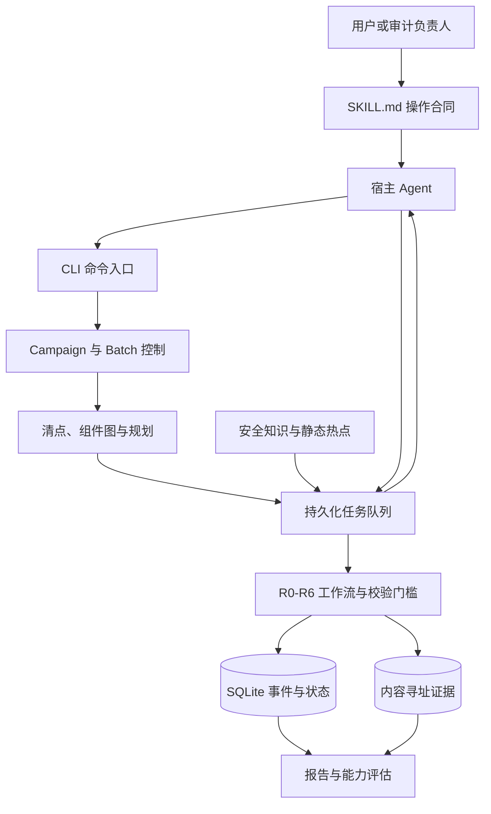

# Reachable Audit：我们为什么这样设计，以及还要证明什么

## 先用一句话介绍

Reachable Audit 是一套帮助 AI 参与大型代码审计的“工作台”：它把审计拆成可分配、可恢复的工作，记录代码版本与证据，并把已检查、未检查和仍有疑问的部分分开呈现。

它不是一个单独运行就能找出所有漏洞的扫描器。真正读代码、分析问题的是接入的 AI Agent 和审阅者；本项目负责组织审计流程、保存材料、检查提交格式，并根据记录整理结果。

## 如何阅读本文

本文同时服务两类读者：

- 如果你只想了解项目，可以重点阅读“遇到的问题”“我们设计了什么”“案例演示”“已知缺陷”和“哪些事情还没有被证明”。
- 如果你需要追踪实现，可以继续阅读“整体架构”“SKILL 如何影响行为”“关键文件地图”“工具与数据流”和“分支与失败处理”。
- 如果你要评估是否采用它，请务必读第 11、12、13、14 节：那里写明了实际测试过什么、成本有多高，以及哪些能力还没有被证明。

正文先解释目的，再给出实现细节。文件名和命令用于建立可追踪关系，不要求普通读者事先了解代码审计。

## 1. 设计动机：为什么需要这个 Skill？

### 之前的项目实践暴露了什么问题？

大型代码库的审计实践暴露出一组相互关联的问题。以下总结的是需要解决的工程问题，不是对任何单个项目的安全结论。

| 遇到的问题 | 为什么这会影响审计 | 我们采取的设计回应 |
|---|---|---|
| 审计范围不清楚：哪些目录、文件、组件实际检查过，常常难以回答 | “没有报告问题”可能只是某些代码没有进入审查，而不是这些代码没有问题 | 固定代码快照；清点源文件；规划工作单元；记录排除、延期和未解决范围；在结案报告中显示覆盖缺口。当前门槛要求 Surface 所属 Work Unit 完成 R1/轴覆盖，但不要求每个 Surface 都生成一个 Hypothesis；未关联 Surface 会单独报告 |
| 大任务不容易分工，跨模块问题容易在交接时丢失 | 输入可能在一个组件进入、在另一个组件触发；单看某个目录会漏掉中间连接 | 把仓库拆成 Work Unit 和 Batch；为跨单元连接建立有负责人的 Handoff；把安全边界和普通构建依赖区分开 |
| 可疑代码容易被当成已确认漏洞 | 命中一个危险 API，不代表攻击者能控制输入并到达该 API | 把“候选线索”和“漏洞结论”分开；要求说明主体、输入、代码路径、敏感操作、防护条件和反证 |
| 只保存最终结论，难以复查分析过程 | 审阅者无法判断结论对应哪个代码版本、哪些材料，或后来是否被修正 | 固定快照；保存带摘要的任务和证据材料；追加记录状态变化与修订，不把修正伪装成从未发生；但 R3 阶段提交后目前没有通用的 verdict 重评级/修订路径 |
| 审计中断或代码变化后，恢复边界不明确 | 可能重复做无效工作，或把旧代码的证据套用到新代码 | 持久化 Campaign/Batch 状态、任务租约和事件；检测快照漂移，并要求受影响的证据重新验证 |
| 多语言支持容易被“适配器存在”或“清单很长”夸大 | 能识别文件或读取构建文件，并不证明能在该语言里找到真实漏洞 | 将语言适配、构建适配、组件边界和审计能力评估分开；要求独立留出样本和按语言报告 |
| 流程完成容易被误解成代码安全 | 完成门槛只说明记录满足了流程条件，不代表找尽所有未知漏洞 | 报告门槛结果的同时，列出未检查范围、未解决边界、证据限制和剩余风险 |

### 为什么不只写一个 Markdown Skill？

这是理解整个项目最关键的问题。

如果目标只是让一个 Agent 对一个小仓库做一次临时代码审查，那么一份 `SKILL.md` 可能已经够用：告诉它阅读哪些文件、关注哪些风险、按什么格式写报告即可。这种方案简单、便宜，也适合快速探索。

但 Markdown 本质上只是**软指令**。它可以要求 Agent 遵守规则，却很难证明规则真的被遵守。例如，文档可以写：

- “请检查所有文件”；
- “请给出源码证据”；
- “请不要重复领取任务”；
- “中断后请从原位置继续”；
- “代码变化后请重新验证”；
- “证据不足时不要下确定结论”。

问题在于，仅凭 Agent 最终写出的一段文字，我们无法可靠回答：

- 它是否真的看过全部文件，还是只看了最显眼的部分？
- 引用的路径和行号是否存在，是否属于本次冻结的代码？
- 它说“不可达”时，是否提供了真实的阻断条件？
- 两个并行 Agent 是否做了同一任务，或者都以为对方会处理某条边界？
- 运行中断后，哪些任务已经完成，哪些结果只是生成了但没有被接受？
- 代码更新后，哪些旧结论已经失效？
- 报告里的覆盖率、发现数量和完成状态，是从记录计算出来的，还是 Agent 自己声称的？
- 没发现问题究竟表示“检查后没有发现”，还是“根本没有检查”？

因此，这个项目不是一份更长的审计提示词，而是给提示词外面增加了一层**可执行约束和证据账本**。

可以用一句话区分两者：

> `SKILL.md` 负责告诉 Agent“应该怎么做”；运行时负责记录并检查“它实际上做了什么、依据是什么、还有什么没做”。

#### Markdown 能约束什么，不能约束什么？

| 能力 | 只有 `SKILL.md` | 加入当前运行时 |
|---|---|---|
| 给出审计方法和注意事项 | 可以 | 可以 |
| 要求某种输出格式 | 可以提出要求，但 Agent 可能漏字段或改格式 | 收集时进行结构校验，不合格结果不能提交 |
| 要求检查全部范围 | 可以提醒 | 根据清点、Work Unit 和路径处置进行对账，缺口保持可见 |
| 要求引用证据 | 可以提醒 | 检查路径、行号、范围和证据摘要是否有效 |
| 多 Agent 分工 | 依赖宿主临时协调 | 使用持久化任务、租约、Worker 身份、重试和幂等键协调 |
| 中断后恢复 | 依赖聊天上下文或人工记忆 | 从 SQLite 状态、事件和证据材料继续 |
| 发现代码变化 | Agent 可能注意不到 | 比较文件摘要，记录漂移影响并阻塞旧证据继续使用 |
| 跨组件交接 | 依赖自然语言约定 | Handoff 有来源、负责人、状态、证据和结案门槛 |
| 修正旧结论 | 容易直接覆盖原文 | 追加修订，保留原记录、原因和新证据 |
| 生成最终报告 | Agent 自己总结，可能遗漏限制 | 从已接受事件和证据推导统计、覆盖和未解决项 |
| 证明审计能力 | 容易把案例或单元测试当成果 | 把日常审计和独立留出评估分开，并显示未通过门槛 |

### 这些代码逻辑到底都在处理什么？

项目的大部分代码并不是在“替 Agent 找漏洞”，而是在处理一次长时间、多任务、可恢复审计中的工程控制问题。可以分成十类：

#### 1. 范围控制：约束“到底检查了什么”

清点、组件图和规划逻辑负责识别源文件、构建单元、语言和候选连接，再把它们分配给 Work Unit 与 Batch。它解决的是：

- 大仓库无法一次放进 Agent 上下文；
- 某些目录可能被无意漏掉；
- “检查项目”这个说法过于模糊，无法追踪到具体文件；
- 构建依赖、运行时安全边界和跨语言连接容易混为一谈。

运行时要求每个范围最终都有处置：实际检查、筛查、排除、延期或未解决。这样，“没有发现”才不会自动掩盖“没有覆盖”。

#### 2. 任务与并发控制：约束“谁在做什么”

任务队列、领取、租约、释放、取消、重试和幂等逻辑处理的是多 Agent 协作：

- 防止两个 Worker 无意中同时提交同一任务；
- 防止 Worker 领取任务后永久消失；
- 区分任务已生成、已领取、结果已收集和阶段已提交；
- 网络重试或重复命令不会重复写入同一决策；
- 重试耗尽后不能无声地无限消耗预算。

这部分很像分布式作业系统，而不是漏洞扫描器。它之所以存在，是因为一次大型审计可能跨越许多 Agent 调用，不能依赖单个聊天会话记住全部状态。

#### 3. 阶段状态机：约束“结论能不能跳步”

R0-R6 的顺序和门槛用于阻止逻辑跳跃。例如：

- 没有固定快照，不能开始入口分析；
- 没有完成范围和边界记录，不能假装 R1 完成；
- 没有结构化假设，不能直接提交可达性结论；
- 没有调用链或阻断证据，不能把假设写成 `REACHABLE` 或 `UNREACHABLE`；
- 没有类别覆盖、交接和剩余风险对账，不能关闭 Batch。

也就是说，运行时不决定 Agent 的安全判断一定正确，但可以拒绝一个**明显缺少必要推理环节**的结果。

#### 4. 证据校验：约束“引用是不是凭空写的”

源码锚点、证据引用和内容寻址存储用于检查：

- 文件是否属于冻结仓库和本次范围；
- 行号是否存在并指向非空代码；
- 调用链的每条关键边是否有支持材料；
- 大型任务结果、实验输出和上下文是否在保存后被改动；
- 报告中的结论能否追溯到原始任务和材料。

SHA-256 摘要不能证明 Agent 对代码的解释正确，但能证明后续读取的是当时保存的同一份材料。

#### 5. 漂移与失效控制：约束“旧证据还能不能继续用”

代码仓库在审计期间可能变化。漂移逻辑比较冻结摘要与当前文件，计算受影响的 Work Unit、Handoff 和结论，并阻止旧结果无说明地进入新报告。

单靠 Markdown，只能要求 Agent “如果发现变化请重新检查”；运行时则把变化记录为事件，并把重新验证变成结案前必须处理的状态。

#### 6. 跨边界交接：约束“问题会不会丢在两个团队之间”

输入可能从 Web 组件进入，在队列组件传递，最后在 Worker 或原生库中触发。如果这些组件属于不同 Batch，仅靠两个 Agent 的自然语言报告，很容易出现：

- 两边都认为对方负责；
- 上游只证明了路径前半段；
- 下游证明了敏感操作，却不知道输入是否来自攻击者；
- 报告把构建依赖误当成安全数据流。

Handoff 逻辑为跨批次边界指定来源、负责人、连接证据和处置状态，并要求两段证据链真正接合后才能作为完整路径使用。

#### 7. 反驳、修订与历史保留：约束“错误结论如何被纠正”

AI 结论不是一次生成后就永远正确。系统保存独立反驳、裁定、复活复核和追加式修订，主要处理：

- 原分析者的确认偏误；
- 后续发现的新防护或新攻击路径；
- 已接受结果需要纠正；
- 报告已经生成，但底层结论后来发生变化。

旧记录不会被直接改写成“从来没有错过”。这样审阅者可以看到谁在什么时候、基于什么证据改变了结论。

#### 8. 实验与资源控制：约束“运行代码时发生什么”

R5 实验逻辑记录命令、环境、超时、资源限制、标准输出、错误输出和清理结果，避免 Agent 只写一句“我测试过了”。资源登记和清理逻辑还处理临时目录与进程。

这些控制的目标是让实验可复核并避免普通失控进程长期占用资源，不是构建强安全沙箱。恶意本机代码仍必须放进外部容器或虚拟机。

#### 9. 报告与结案控制：约束“完成意味着什么”

报告不是让 Agent 凭记忆重新总结，而是从已接受的事件和证据推导。结案逻辑对账：

- 每个阶段是否完成；
- 哪些范围实际检查、筛查、排除或延期；
- 哪些 Handoff 仍未解决；
- 哪些漂移尚未重新验证；
- 哪些发现已证实，哪些仍需要复核；
- token 用量是否完整；
- 当前关闭的是一个 Batch，还是整个 Campaign。

它主要防止“成功形状的报告”：文字看起来完整，但实际仍有未完成任务和未知风险。

#### 10. 能力评估：约束“我们能对外声称什么”

测试和评估逻辑将三件容易混淆的事情分开：

1. 软件机制是否按设计工作；
2. 某次真实项目试跑是否顺利完成；
3. 系统是否真的提高漏洞发现能力。

单元测试只能回答第一项。要回答第三项，还需要冻结的留出样本、独立答案、配对预算和按语言/风险主题报告。评估层存在的原因，就是防止项目把“代码很多、流程能跑、适配器存在”宣传成“审计能力已经证明”。

### 为什么我们选择这么重，而不是保持简单？

因为项目要解决的目标已经不是“给 Agent 一些审计建议”，而是：

> 在大型仓库、多 Agent、多阶段、可能中断和代码变化的条件下，保留一条可以复查的证据链，并让未覆盖、未证明和未解决的部分无法轻易消失。

重量主要来自四个要求：

1. **可恢复：** 任务不能因为聊天中断而全部丢失；
2. **可对账：** 每个文件、边界、假设和类别最终要有状态；
3. **可追溯：** 每个结论能回到固定代码、任务和证据；
4. **失败关闭：** 缺字段、缺范围或缺证据时宁可阻塞，也不生成成功外观。

如果不需要这些性质，完全可以只使用一个轻量 `SKILL.md`。当前架构更适合高价值、周期较长、需要多人或多 Agent 复核，并且必须解释“为什么得出这个结论”的审计；它并不适合所有日常代码检查。

### 这套重逻辑仍然约束不了什么？

必须避免另一种误解：运行时代码很多，不代表它可以把不可靠的 Agent 自动变成安全专家。它仍然不能保证：

- Agent 已经理解业务真实威胁模型；
- 一条看似完整的调用链在语义上绝对正确；
- 所有未知漏洞都已经被提出；
- 独立反驳者一定比原分析者更聪明；
- 没有发现就等于没有漏洞；
- 流程门槛通过就等于项目安全。

它约束的是**工作过程、证据形状、状态变化和能力声明**，不是直接约束模型内部如何思考，也不能替代专家对高影响结论的复核。

### 我们针对这些问题设计了什么？

#### 1. 先锁定“检查的是哪一版”

一次审计活动（Campaign）针对固定的代码快照。审计期间如果源文件发生变化，系统记录变化及其影响；依赖这些文件的结论不能不加说明地继续沿用。这样做是为了让证据和结论指向同一份代码。

#### 2. 把大仓库拆成有边界的工作

规划器把文件分配给较小的 **Work Unit（工作单元）**，再组织成可独立推进的 **Batch（批次）**。跨工作单元或批次的组件连接通过 **Handoff（交接）**明确负责人和处理状态。一个 Batch 完成，不自动表示整场审计已完成。

语言、构建系统和组件是不同概念：语言适配器帮助理解源码线索；构建适配器解析项目依赖；它们提供的连接只是线索，不能直接证明实际的安全调用或数据流。

#### 3. 让“可疑点”经过验证再成为结论

审计流程将发现拆成几个阶段：

| 阶段 | 通俗解释 |
|---|---|
| R0 | 固定版本、范围、工具和审计约束 |
| R1 | 找出外部入口、调用者、组件和信任边界 |
| R2 | 提出可以被证实或推翻的风险假设 |
| R3 | 沿代码证据验证输入是否到达敏感操作，并检查拦截条件 |
| R3.5 | 由独立审阅者尝试反驳重要结论并参与裁定 |
| R4 | 检查计划内的安全类别，并记录哪些范围实际经过检查 |
| R5 | 在静态分析不能解决关键疑问时，运行有理由、有记录的实验；不能实验时保留未解决状态 |
| R6 | 对账发现、证据、交接、未覆盖范围和剩余风险 |

不是所有假设都需要运行实验，也不是每条可疑线索都会成为漏洞。系统要求记录防护条件和反证；证据不足时应保留“不确定”，而不是用确定语气掩盖未知。

#### 4. 保存过程，而不只保存报告

Campaign 和 Batch 的状态与事件保存在 SQLite 中；较大的任务输入、输出和实验结果作为带内容摘要的证据材料保存。报告从这些记录推导。若结论需要修正，设计目标是保留原记录并追加有依据的修订，方便回看变化原因。

这些机制主要保证记录可追踪、材料可核对，并不自动证明 Agent 的推理正确，也不意味着存储系统已经经过对抗性安全认证。

#### 5. 把能力评估当成一项独立工作

项目设定了 15 种语言的评估组合：C、C++、C#、Go、Java、Rust、Python、JavaScript、TypeScript、Kotlin、Scala、PHP、Ruby、Swift 和 Shell。当前设计为每种语言准备风险主题，并计划使用不参与日常分析的留出样本评估表现。

这 15 种语言是目标清单，不是已经通过认证的名单。读懂某个语言的文件、运行单元测试或存在适配器，都不能单独证明系统能在该语言中稳定发现漏洞。

## 2. 整体架构：各部分如何协作

可以把系统分成“宿主”“流程引擎”“分析辅助”和“持久化/评估”四层：



- **宿主 Agent**读取任务、检查目标代码并返回结构化结果。它是分析执行者，不属于本项目内置的静态分析器。
- **CLI 与 Campaign 控制层**把用户意图转换为初始化、清点、规划、任务、阶段和结案操作。
- **清点与规划层**识别源码、语言、构建单元及候选连接，再将范围分配给 Work Unit 和 Batch。
- **持久化任务队列**负责调度、领取、租约、收集、重试和提交，使工作中断后仍可继续。
- **工作流层**实施 R0-R6 的顺序、输入合同和完成条件。
- **安全知识与热点分析**只提供候选方向、反证提示和验证方法，不直接发布漏洞结论。
- **SQLite 与证据仓库**分别保存状态/事件和较大的不可变材料；报告从两者推导。
- **评估层**检查流程材料和独立能力证据。它与日常审计分开，避免“能运行”被误写成“有效果”。

## 3. 指令分析：`SKILL.md` 如何影响行为

`SKILL.md` 不是程序源码，而是宿主 Agent 的操作合同。它说明何时使用这套工作流、不可违反的规则、任务输入输出格式和推荐命令顺序。代码负责强制其中一部分合同；其余规则依赖宿主 Agent、执行环境或审阅者遵守。

### 触发条件

Skill 的元数据将使用范围限定为：明确测试或开发这套面向大型仓库的 Campaign/Batch 审计工作流。它不是看到任意代码问题就应该自动触发的通用检查器。这个限制减少误用，也意味着是否正确触发仍依赖宿主平台加载并遵守元数据。

### 对行为影响最大的规则

| 规则类别 | 对实际行为的影响 |
|---|---|
| 完成条件 | 缺少必要阶段时不能报告审计完成；Batch 完成不能冒充整个 Campaign 完成 |
| 证据要求 | Surface 必须指向项目内真实代码行；只有实际检查过的范围才能声明为已覆盖 |
| 任务路径 | R1/R2 默认通过持久化任务调度、领取、收集和提交，直接导入只用于恢复 |
| 历史隔离 | 新审计默认不把过去的发现、排除项和经验作为发现阶段输入；跟进审计必须明确声明历史来源 |
| 输出合同 | Worker 必须沿用任务自带的 schema，不能由宿主提示词临时改写输出结构 |
| 失败策略 | 缺字段、范围不完整或结构错误时拒绝收集，并尽量保留租约供原 Worker 修正 |
| 实验安全 | 运行实验必须登记进程和临时资源；内置资源限制不能被描述成安全沙箱 |
| 诚实报告 | 未检查范围需要结构化处置；门槛通过只表示规定材料齐备，不代表代码绝对安全 |

例如，R1 任务若声称检查了全部文件，结果必须使用规定的 `ALL_SOURCE_FILES` 值；如果边界审查缺项，收集会失败并列出缺口。R2 必须对六个分析轴分别记录适用、无关或延期，不能只提交有发现的部分。R3 的 `REACHABLE` 结论需要调用链和边证据，静态阶段不能冒充实验确认。

这些规则的价值在于减少“提示词说完成了，但没有可核对材料”的情况。局限是：规则可以验证结构和引用，却不能独自判断一段代码是否真的支持安全结论。

## 4. 文件分析：关键文件分别负责什么

下表只列对理解设计最重要的文件和目录，而不是逐一罗列仓库内容。

| 文件或目录 | 主要责任 |
|---|---|
| `SKILL.md` | 宿主 Agent 的触发条件、硬规则、任务循环、结果 schema 示例和命令手册 |
| `README.md` | 项目定位、能力边界、快速开始和设计文档入口 |
| `src/reachable_audit/cli.py` | 命令行入口；把 `init`、`inventory`、`plan`、阶段命令和任务命令路由到对应服务 |
| `src/reachable_audit/campaign.py` | Campaign 生命周期、快照识别、计划/报告材料和顶层服务边界 |
| `src/reachable_audit/models.py` | Campaign/Batch 状态、合法状态转换以及基础事件模型 |
| `src/reachable_audit/inventory.py` | 源文件、语言、构建清单及组件归属清点 |
| `src/reachable_audit/graph.py` | 构建依赖、导入关系和候选组件边界图 |
| `src/reachable_audit/planning.py` | 将清点结果拆分为 Work Unit、Batch 和跨批次交接 |
| `src/reachable_audit/execution.py` | 持久化任务合同、Agent 上下文、调度/领取/收集/提交和结果校验 |
| `src/reachable_audit/batch_workflow.py` | R0-R6 阶段行为、代码锚点验证、阶段顺序和 Batch 门槛 |
| `src/reachable_audit/handoffs.py` | 跨工作单元/批次边界的负责、解决和证据整合 |
| `src/reachable_audit/store.py` | SQLite 状态、追加事件、幂等键、任务租约和索引 |
| `src/reachable_audit/artifacts.py` | 以 SHA-256 内容摘要保存和校验证据材料 |
| `src/reachable_audit/knowledge_catalog.py` | 加载并检查语言风险资料、机制卡片和来源信息 |
| `src/reachable_audit/discovery/hotspots.py` | 生成源代码热点候选；当前主要是范围有限的 Python AST 规则 |
| `src/reachable_audit/experiments/` | 工具链环境探测、实验配方和受资源约束的命令运行 |
| `src/reachable_audit/evaluation.py` | 读取签名评估材料并计算能力验收门槛 |
| `docs/design/` | 系统目标、软件合同、需求追踪、修复路线图与验收方案 |
| `tests/` | 验证状态机、任务合同、证据、边界、实验和评估机制；不等同于真实漏洞发现能力证明 |

从设计到代码的追踪路径通常是：设计文档说明“为什么和应该怎样”，需求文档标记实现状态，`SKILL.md` 约束宿主用法，`src/` 实现可执行合同，`tests/` 验证可自动检查的部分。

## 5. 执行机制：从输入到结果发生了什么

一次正常运行的数据流如下：

1. **初始化：** 用户指定目标仓库、Campaign ID、快照、审计模式和预算。若未显式给快照，系统只接受干净 Git 工作树自动生成的提交标识。
2. **清点：** `inventory` 扫描源文件、语言和构建单元；`graph` 生成本地依赖和候选边界，并保留无法识别的项目。
3. **规划：** `plan` 根据文件数量、组件和边界拆出 Work Unit 与 Batch，生成稳定的计划及交接记录。
4. **R0 校验：** Batch 开始前重新计算范围内文件摘要；发现代码漂移时阻塞 Batch，并记录受影响范围。
5. **任务调度：** 每个阶段先生成持久化任务。Worker 领取任务后得到范围、输出 schema、分析要求、相关安全知识和热点摘要。
6. **Agent 分析：** 宿主 Agent 读取允许的源码，返回 Surface、假设、可达性判断、反证、覆盖处置或实验评估。
7. **收集与提交：** `task-collect` 检查任务身份、Worker、输出大小、必填结构和范围完整性；阶段提交再检查代码锚点和阶段关系，并写入事件和证据。
8. **复核与实验：** 对重要结论安排独立反驳和裁定；只有能解决关键未知时才运行实验，并记录命令、环境、输出和限制。
9. **Batch 收尾：** R6 检查该批次的证据、发现、类别覆盖、交接和剩余风险。
10. **Campaign 收尾：** 所有相关 Batch 和 Handoff 对账后，单独执行 Campaign 门槛并生成最终报告。报告同时显示发现与限制。

### 为什么要拆成 R0-R6？

这套流程不是为了把审计步骤写得复杂，而是为了防止几种常见的逻辑跳跃：

- 代码已经变化，却继续沿用旧证据；
- 看见危险 API，就直接宣布存在漏洞；
- 只追踪 Agent 惹眼的几个可疑点，却漏掉整类风险；
- 实验失败，就误判为“漏洞不存在”；
- 一个批次做完，就把它写成“整个项目已经安全”。

因此，R0-R6 实际上构成一条逐步收紧结论的证据漏斗：

```text
R0 固定事实基础
 ↓
R1 画出攻击面和边界
 ↓
R2 提出可证伪假设
 ↓
R3 用静态代码证据验证
 ↓
R3.5 由独立角色尝试推翻
 ↓
R4 从安全类别角度检查遗漏
 ↓
R5 只对关键未知做实验
 ↓
R6 对账范围、证据和剩余风险
```

其中有两条互补的审计路径：

- **假设驱动路径（R1-R3.5）：** 从攻击入口出发，提出具体假设，再沿代码链验证并反驳，适合回答“这条攻击路径是否真实存在？”。
- **类别覆盖路径（R4）：** 按计划内的安全类别逐项回看工作单元，适合回答“我们是否因为没有提出某个假设，而完全漏掉了一类风险？”。

R5 不是每条假设的必经步骤，而是前两条路径都无法解决关键行为问题时才启用。R6 也不再做新的漏洞推理，而是检查前面的工作是否能够诚实结案。

### R0：先证明“我们检查的是同一份代码”

**设计动机：** 代码审计结论只能对特定版本成立。如果审计过程中代码被修改，旧行号、调用链和防护条件都可能失效。没有 R0，后续证据即使写得很完整，也可能指向不同版本的代码。

**输入：** Campaign 冻结快照、Batch 清单、Work Unit 文件范围和预期摘要。

**主要动作：**

- 确认 Batch 中的每个文件都属于冻结清单；
- 重新计算当前文件摘要，并与预期摘要比较；
- 发现漂移时记录受影响的工作单元和结论，并阻塞相关 Batch。

**输出和门槛：** 生成包含快照、范围和文件摘要的 R0 收据。只有 R0 完成，R1 才能开始。

**为什么不能省略：** Git 提交号只能说明计划检查哪个版本；R0 还要证明 Worker 开始工作时实际读到的文件仍是那个版本。

### R1：先画攻击地图，不急着判断漏洞

**设计动机：** 审计最容易犯的错误之一，是直接搜索危险函数，却不知道攻击者从哪里进入、以什么身份进入，以及数据跨过了哪些组件和信任边界。R1 先建立“地图”，把事实发现与漏洞判断分开。

**输入：** 通过 R0 校验的工作单元、源文件、组件图、候选边界和仅供导航的热点线索。

**主要动作：**

- 识别外部入口、调用主体、组件归属和源码位置；
- 记录每个入口是已检查、未产生假设、延期还是仍需处理；
- 对计划器给出的候选边界逐一确认、否认或保留未解决状态；
- 明确哪些路径被检查、排除或延期，不能只上报“有发现”的文件。

**输出和门槛：** 形成带源码锚点的 Surface、边界审查和范围处置记录。边界漏审、路径处置缺失或源码位置无效都会阻止 R1 提交。

**为什么不能与 R2 合并：** 如果只保存最终假设，那么“检查过但没有形成假设”的入口会从记录中消失，系统也就无法区分“没有问题”和“根本没有看过”。

### R2：把怀疑写成可以被推翻的假设

**设计动机：** “这里看起来危险”不能被验证。R2 要把直觉转成结构化、可证伪的问题：谁能控制什么输入，经过什么机制，在什么条件下，可能到达什么敏感操作。

**输入：** R1 的入口与边界、工作单元范围、适用的语言风险资料、机制卡片和热点摘要。

**主要动作：** 从六个互补分析轴检查风险：

1. **入口轴：** 从外部 Surface 和攻击主体出发；
2. **机制轴：** 从反序列化、注入、内存错误等失效机制出发；
3. **状态/生命周期轴：** 检查初始化、并发、缓存、清理和状态转换；
4. **修复变体轴：** 查找已修复问题的相邻实现、复制版本或绕过变体；
5. **边界轴：** 检查跨组件、跨权限域和跨语言连接；
6. **差异行为轴：** 比较配置、平台、版本、错误路径或部署模式差异。

每个轴都必须记录 `APPLICABLE`、`NOT_APPLICABLE` 或 `DEFERRED`。没有生成假设也是合法结果，但必须说明检查了什么；标记不适用或延期也必须给出范围和理由。

**输出和门槛：** 每条 Hypothesis 都要绑定工作单元、来源轴、种子证据、机制、已知入口和源码位置。缺少这些字段的“猜测”不能进入 R3。

**为什么使用六个轴：** 单一提示方式容易形成思维盲区。六个轴不是要求把仓库机械地扫描六遍，而是要求对不同思考角度逐项交代，防止某个角度被无声省略。

### R3：用静态证据验证真实可达性

**设计动机：** 危险入口和危险操作同时存在，不代表攻击者能够让数据从前者到达后者。R3 把“可能”推进为有代码证据的临时判定。

**输入：** R2 的全部假设以及冻结快照中的源码和构建材料。

**主要动作：**

- 从声明的攻击主体和入口开始，追踪有序调用链或数据流；
- 为链上的关键边提供源码证据；
- 检查认证、校验、编码、权限、不可达部署条件等反证和拦截条件；
- 对每个假设给出 `REACHABLE`、`UNREACHABLE` 或 `NEEDS_REVIEW`。

**输出和门槛：**

- `REACHABLE` 必须有非空、有序且逐边有证据的路径，并说明前置条件；
- `UNREACHABLE` 必须有可信的阻断证据；
- 证据不足必须保留为 `NEEDS_REVIEW`，不能靠猜测补齐；
- 静态分析不能把结果写成“已经通过运行实验证实”，经验性确认只属于 R5。

**为什么仍称为临时判定：** R3 的链条可能遗漏间接调用、部署差异或隐藏防护，因此重要结论还要经过 R3.5 的独立反驳。

### R3.5：让另一个角色专门寻找“我们为什么错了”

**设计动机：** 提出假设的人容易偏向证明自己的判断。R3.5 将确认偏误当成流程问题处理，而不是寄希望于同一个 Agent 自我纠正。

**输入：** R3 判定及其支持证据、反证和未解决条件。

**主要动作：**

- 由身份不同的 Worker 独立寻找遗漏防护、错误调用链、不可控输入或被夸大的影响；
- 反驳者不能先看到其他反驳者的结论；
- 裁定者不能裁定自己提交的反驳；
- 对初始 `UNREACHABLE` 结论进行复活复核，防止错误的否定结论让真实风险永久消失。

**输出和门槛：** 保存反驳证据、争议点、正反材料、裁定者和最终处置。成功反驳或复活会重新打开假设，并使依赖旧结论的下游结果失效，直到重新检查。

**为什么放在 R4 前：** R4 要基于一组经过质疑的假设和判定检查类别覆盖；否则错误的早期结论会被后续覆盖表原样放大。

### R4：从安全类别反向检查遗漏

**设计动机：** 即使每条已提出的假设都验证得很好，Agent 仍可能完全没有想到某类风险。R4 不再只问“这些假设对不对”，而是问“计划要求检查的风险类别是否真的检查过”。

**输入：** 计划内的 Work Unit/安全类别组合，以及 R2 假设和 R3 判定。

**主要动作：**

- 对每个计划内的工作单元和安全类别记录 `COMPLETE`、`NOT_APPLICABLE` 或 `DEFERRED`；
- 保存检查证据、覆盖范围和未解决问题；
- 可以把已经存在的正式 Finding 归属到相应类别，但不能借类别任务绕过 R2-R3 流程直接制造 Finding；
- 没有发现漏洞可以是有效结果，但“零发现”必须伴随检查证据。

**输出和门槛：** 所有计划组合都必须有可解释处置。新发现的候选问题要作为剩余风险保留，或重新送入假设验证路径。

**为什么 R3 和 R4 都需要：** R3 保证单条结论有深度，R4 保证计划范围有广度；只有深度会漏类别，只有广度又容易退化成打勾式检查。

### R5：只在静态证据无法回答时做实验

**设计动机：** 有些问题取决于运行时配置、库版本、序列化格式或并发行为，单看源码无法可靠判断。但“能运行一条命令”也不代表实验可信，所以实验必须晚于静态分析，并绑定具体未知。

**输入：** 需要经验性确认的假设、R3/R4 暴露的关键未知、实验配方、环境和工具链信息。

**主要动作：**

- 说明为什么需要实验，以及实验要区分哪些可能结果；
- 记录前置条件、精确命令或动作、输入、观察、工具版本、保真度和清理结果；
- 将实验绑定到对应 Hypothesis；未绑定的独立运行不能升级 R5 结论；
- 工具缺失、环境不安全或实验不可行时，明确记录 `NOT_FEASIBLE` 或 `NEEDS_REVIEW`。

**输出和门槛：** 生成可复核的实验材料和评估。启动失败、超时或环境缺失不是“漏洞不存在”的证据；外部实验还需要来源和审阅者证明。

**为什么不是所有假设都实验：** 实验昂贵、可能有副作用，也可能因环境失真产生错误信心。源码证据已经足够时，额外实验不会自动让结论更可靠。

### R6：结案前对账，而不是再做一次分析

**设计动机：** 前面各阶段分别产生入口、假设、判定、复核、类别记录和实验。如果不统一对账，很容易出现“发现有证据，但交接没完成”或“报告说已覆盖，实际还有延期路径”的情况。

**输入：** R1-R5 的全部阶段材料、正式 Finding、Handoff、漂移事件、遗漏路径和剩余风险。

**主要动作：**

- 核对阶段产物是否与 Batch 清单一致；
- 列出仍开放的跨批次交接、漂移、延期、排除范围和未知问题；
- 区分已证实发现、被否定假设、未解决风险和工具/环境限制；
- 从不可变记录推导 Batch 报告，而不是让 Worker 自行填写工具拥有的统计字段。

**输出和门槛：** 生成 Batch 结案证据和剩余风险声明。任何必需材料没有闭合时，Batch 应保持开放或阻塞。

**为什么 R6 不等于项目审计完成：** R6 只关闭一个 Batch。只有全部 Batch、跨批次 Handoff 和 Campaign 级门槛都完成后，才能生成全项目报告；即使如此，报告也只能说明本次约定范围内做了什么，不能证明项目绝对安全。

### 在这些阶段中，程序、Agent 和人分别负责什么？

| 参与者 | 能负责的事情 | 不能自动保证的事情 |
|---|---|---|
| Reachable Audit 运行时 | 固定阶段顺序，生成任务，检查 schema、范围、源码锚点、证据引用和覆盖数量，保存事件并阻止缺项结案 | 不能仅凭字段齐全判断调用链在语义上一定正确，也不能证明漏洞真实存在 |
| 宿主 Agent/Worker | 阅读源码，识别入口，提出假设，追踪调用与数据流，寻找反证，解释实验观察 | 不能自行修改阶段门槛，也不能把未经证实的判断包装成运行时已验证事实 |
| 独立反驳者和裁定者 | 从不同立场复核高风险结论，比较正反证据并记录争议处置 | 独立身份本身不等于判断正确，仍可能共同遗漏同一问题 |
| 人类操作者或安全审阅者 | 决定审计范围、预算、例外和外部隔离要求，检查高影响结论并承担最终使用责任 | 不能因为流程完整就宣称项目绝对安全 |

因此，R0-R6 的主要价值是让推理过程可追踪、缺口可见、结论可反驳。它能验证很多**结构条件**，但无法自动验证所有**语义真相**。

### 阶段拆分带来的代价

这种设计让“没检查”“没证据”“被反驳”“实验不可行”和“仍有交接”保持可见，但代价也很直接：任务数量增加、上下文重复、独立复核和失败重交都会消耗更多 token。第 12 节会专门解释这项成本缺陷。阶段不能为了省 token 被随意跳过；合理的优化方向是减少重复上下文和不必要任务，而不是隐藏覆盖缺口。

任务在 Agent 和运行时之间主要传递 JSON。小型状态和事件进入 SQLite；较大的上下文、结果和实验输出进入内容寻址证据仓库，事件只保存引用。这避免在每条事件中复制大型内容，也允许读取时重新核对摘要。

## 6. 工具与依赖：调用什么，数据如何传递

项目要求 Python 3.11 或更新版本，运行时没有第三方 Python 包依赖；开发测试使用 pytest。核心外部交互包括：

| 工具或能力 | 用途 | 数据如何进入系统 |
|---|---|---|
| Git 命令 | 在工作树干净时读取提交并生成快照标识 | `CampaignManager` 调用 Git，保存快照 ID；脏工作树会被拒绝或要求显式快照 |
| 宿主 Agent | 阅读源码、推理并产生阶段结果 | 领取 JSON 任务，返回符合任务 schema 的 JSON 结果 |
| 语言适配器 | 提供扩展名、模块、符号、边界提示及工具链信息 | 清点和任务构建读取注册表中的语言能力 |
| 构建适配器 | 解析常见构建清单和本地依赖 | 组件图保存已解析边以及不支持/未解决诊断 |
| Python AST 热点提供者 | 为部分 Python API 产生候选代码位置 | 候选被压缩进 R1/R2 任务上下文，不能直接成为 Finding |
| 注册的工具链探测 | 运行有限的版本检查 | 探测结果作为环境信息；工具存在不代表完成审计 |
| 实验运行器 | 以 argv、超时和资源限制运行必要实验 | 标准输出、错误输出和观察结果保存为证据；可通过假设 ID 绑定 R5 |
| SQLite | 保存 Campaign、Batch、事件、租约和索引 | 服务层通过事务和幂等键写入结构化状态 |
| 文件证据仓库 | 保存不可变的大型任务/实验材料 | 内容经 SHA-256 寻址，读取时再次校验摘要 |

当前实现不依赖一个必须在线调用的外部漏洞 API，也不会自动调用另一个 Skill 来替它完成审计。宿主平台可以委派其他 Agent，但委派身份、预算和证明仍是当前未完全闭合的问题。

## 7. 分支与异常：什么时候改变路径，失败后怎么办

系统不是一条无条件直通的流水线。重要分支包括：

| 情况 | 系统走向 |
|---|---|
| 新的独立审计 vs. 明确的跟进审计 | 新审计隔离历史材料；跟进审计必须声明同一目标的历史 Campaign，且旧结论仍不能代替当前证据 |
| 紧凑 R2 vs. 按分析轴拆分 R2 | 默认一个 Work Unit 一项紧凑任务；只有独立 Worker 或上下文隔离确有价值时才拆成六项 |
| 静态证据充分 vs. 需要实验 | 源码证据足以判定时不必实验；关键行为不确定时进入 R5；实验做不到应保留未知，而非猜测 |
| 候选边界被确认、否认或未解决 | 分别进入后续证据链、带证据标记为非安全边界，或继续阻塞依赖它的结论 |
| 范围全部检查 vs. 筛查/排除/延期 | 只有实际检查的范围可计为 inspected；其他状态单独统计并说明原因 |

典型失败处理如下：

- **脏工作树或快照漂移：** 初始化要求显式冻结方式；R0 发现漂移后阻塞相关 Batch，受影响结论需要重新验证。
- **任务结果缺字段或覆盖不全：** 收集失败并给出缺口，任务通常保持租约，原 Worker 可以修正后再次提交。
- **Worker 无法继续：** 未开始的租约可以释放；失败重试有上限，耗尽后需要操作者给出理由才能授权额外尝试。
- **阶段依赖不满足：** 后续阶段或结案门槛失败，Campaign 保持开放/阻塞，而不是生成成功外观的结果。
- **结果过大：** 结果有建议大小和硬上限；计划阶段会提示预计过大的工作单元，应在派发前拆分，而不是删减必需覆盖。
- **实验超时或资源异常：** 运行器终止进程组并保存观察；资源限制只是保护宿主资源，不能保证恶意代码被安全隔离。
- **主动终止 Campaign：** 使用专门的 abort 流程记录原因和工具问题并清理已登记资源；可恢复的门槛失败不应被误当成主动放弃。

## 8. 设计权衡：为什么这样做

| 选择 | 获得的优势 | 付出的代价或潜在问题 |
|---|---|---|
| 固定快照和严格漂移处理 | 证据与代码版本一致 | 活跃开发中的仓库需要额外冻结和重验证成本 |
| 拆分 Work Unit/Batch | 可并行、可恢复、适合大仓库 | 边界划分不当会增加交接；过度拆分可能提高上下文和调度成本 |
| 事件追加而非覆盖状态 | 可以审计历史和解释修订 | 数据模型、报告投影和下游失效处理更复杂 |
| 候选与结论分离 | 降低把模式匹配当漏洞的风险 | 需要 Agent/审阅者投入更多验证工作 |
| 严格 JSON 合同和失败关闭 | 结果更可组合，缺失覆盖不易被隐藏 | Worker 输出必须精确，可能增加重试和操作负担 |
| 安全知识按任务注入 | 控制上下文并记录遗漏内容 | 预算裁剪可能产生语言/风险类型偏差，需要评估监控 |
| 独立反驳和留出评估 | 更容易发现过度确信，并能测量真实能力 | 需要额外 Agent、人工裁定、样本和成本 |
| 资源受控实验而非内置强沙箱 | 实现简单，可记录常规行为实验 | 无法安全承载对抗性本机代码，必须依赖外部隔离 |
| 覆盖优先于体积，必需项不能为省 token 省略 | 覆盖缺口无法被悄悄掩盖，结论更可信 | token 消耗很高；可选成本 forecast 依赖调用方假设，核心 runtime 仍无金额硬闸（见第 12 节） |

## 9. 实例演示：检查一个上传处理服务

下面是假想案例，用于说明机制，不代表仓库已经实际审计过这个项目，也不是能力证明。

假设一个 Python 服务允许用户上传任务文件，处理函数把上传内容交给 `pickle.loads`。团队想确认远程用户是否可能触发不安全反序列化。

### 第一步：初始化和规划

负责人锁定 Git 提交，建立新的 Campaign。`inventory` 识别 Python 文件和项目清单，`graph` 记录 Web 入口组件与后台处理组件之间的候选连接，`plan` 将它们分配到两个 Work Unit。由于入口和敏感操作跨单元，计划创建一个 Handoff。

### 第二步：发现入口

R1 Worker 检查 Web Work Unit，记录一个 Surface：

- 主体：未登录的远程用户；
- 入口：上传接口的具体代码行；
- 可控数据：上传文件内容；
- 跨组件去向：后台任务队列。

Python 热点提供者可能在另一个 Work Unit 标记 `pickle.loads`，但这个标记此时只是导航线索。

### 第三步：提出并验证假设

R2 形成可证伪假设：“未登录用户上传的数据未经可信签名验证，经过任务队列到达 `pickle.loads`，可能导致执行反序列化载荷。”

R3 随后必须读取两端及中间代码，检查：

- 上传内容是否原样进入队列；
- 队列消费者是否反序列化同一数据；
- 是否存在签名、格式白名单、权限或隔离措施；
- 部署配置是否让远程用户真正到达该入口；
- 跨 Work Unit 的 Handoff 是否有两端证据。

如果代码显示服务器只反序列化自己生成并经密钥认证的数据，假设可能被阻断；如果签名检查可绕过，结论仍需记录绕过路径，而不能只引用 `pickle.loads`。

### 第四步：反驳和实验

独立审阅者尝试寻找遗漏的签名验证、队列权限或不可达部署条件。若源码无法确认部署时使用的序列化格式，R5 可以在隔离环境中运行最小实验，并将命令、版本、输入和观察结果绑定到该假设。若实验需要运行不可信载荷，则必须使用外部容器或虚拟机，不能把内置资源限制当作安全边界。

### 第五步：报告

如果路径和影响得到充分支持，系统记录 Finding，并保留入口、跨组件路径、敏感操作、反证检查和复核结果。如果后台组件未检查完成或边界仍未解决，报告应写“证据链未闭合”，而不是把热点候选升级为确认漏洞。

这个案例展示了核心差异：项目的价值不在于看到一个危险函数，而在于组织并保存“谁能控制什么、数据如何到达哪里、什么会阻止它、结论如何被复查”的完整过程。

## 10. 通俗解释：把审计想成建筑消防检查

可以把一次 Campaign 想成一次大型建筑消防检查：

- 固定快照相当于锁定检查当天的建筑图纸；
- Work Unit 是分给检查员的楼层或区域，Batch 是一组可独立验收的检查任务；
- Surface 是门、窗、通风口等外部入口；
- 敏感操作是配电房、燃气阀等高风险位置；
- Handoff 是管线跨楼层时两名检查员之间的交接单；
- 热点规则像“看到老化电线就做标记”，标记本身不等于火灾一定发生；
- 反证是保险装置、隔离墙或实际不可连通的管线；
- Artifact 是照片、测量记录和图纸页码；
- R6 与 Campaign 收尾是对账检查表，但表格填完也不能证明未来绝不发生事故。

## 11. 目前的成果：测试过什么

介绍成果时，需要区分三种完全不同的证据：

1. **自动化测试：** 证明软件机制对测试输入按预期工作；
2. **真实项目试跑：** 暴露工作流在实际规模和代码形态下的问题；
3. **能力验收：** 证明系统能在未知项目中以可接受的召回率和误报率发现真实漏洞。

当前公开仓库对第一类证据最完整；第二类已有真实大仓库 Campaign 报告，但该 Campaign 未完整结案；第三类尚未完成。因此，下面只给出匿名化的范围和结果摘要，不列目标项目、内部路径或源码细节，也不会把测试夹具包装成生产项目。

### 公开可复核的合成项目

测试套件会在临时目录中创建小型项目，用来验证明确的软件合同：

| 合成项目类型 | 包含的技术 | 验证的成果 |
|---|---|---|
| 多构建系统组件仓库 | Python/`pyproject.toml`、Rust/Cargo、Go Modules | 能识别六个构建单元，并解析三个项目内本地依赖 |
| 扩展构建生态仓库 | npm、Maven、Gradle、Swift Package Manager、CMake | 能解析这些生态中的本地组件关系，并保留构建单元身份 |
| 混合语言目录 | Python、TypeScript、C++，以及目标组合外的 PowerShell、Objective-C | 能同时保留多语言归属，并把已识别但不支持的语言显式标记出来 |
| 跨批次三组件项目 | `entry`、`parser`、`decoder` 三个 Python 组件 | 能把跨 Batch 的调用链拆成交接事项，并在证据齐备后整合 |
| 快照漂移项目 | 应用组件、依赖库和无关组件 | 修改依赖代码时，只让反向依赖范围的证据失效，不把无关工作全部作废 |
| Python 热点样例 | `subprocess`、`pickle`、`os.system`，以及相似但无关的名称 | 能产生带代码行的候选、识别常见别名、报告语法错误/不支持文件，并避免部分名称相似误报 |
| 任务与恢复场景 | 多 Worker、租约、失败、释放、重试、修改后提交 | 能持久化任务状态，拒绝不完整结果，并为可修复失败保留恢复路径 |
| 证据与结案场景 | 内容摘要、阶段门槛、修订、排除/延期范围 | 能检测证据损坏、区分 Batch/Campaign 完成，并在报告中保留未解决范围 |
| 受控实验场景 | 正常输出、超时、目录逃逸尝试 | 能保存输出、终止超时进程组，并拒绝目标根目录之外的工作目录 |

语言适配器测试还使用 15 种语言的最小源码片段，检查符号提取、项目相对位置规范化，以及常见本地模块引用解析。这证明适配器合同在这些样例上工作，不证明它们理解每种语言的全部语法和真实工程构建行为。

### 实际语言覆盖远低于 15 种

必须明确说明：我们并没有用全部 15 种语言实际测试过这套审计流程。不同语言得到的验证深度差别很大。

| 验证深度 | 覆盖的语言 | 实际做了什么 |
|---|---|---|
| 流程执行证据 | Python；另有一次大型混合语言真实 Campaign | Python 合成夹具通过 R0-R6；真实 Campaign 约 2GB、1.7 万源文件，13 个 Batch 中 11 个完成 R6，另 2 个未闭合，因此不是完整结案或发布验收 |
| 构建清单与组件解析 | Python、Rust、Go、JavaScript/TypeScript、Java、Kotlin、Swift、C/C++ | 通过各自的构建文件验证组件识别和本地依赖解析，但没有在这些语言上跑完整审计 |
| 仅最小片段适配器测试 | 上述之外的 C#、Scala、PHP、Ruby、Shell 等 | 只验证了符号提取、路径规范化和简单模块引用，没有真实项目、没有热点规则、没有审计结果 |
| 独立留出能力未认证 | 全部 15 种 | 没有任何语言达到发布所需的独立留出样本门槛；这不否定适配器测试或局部 Campaign 运行证据 |

换句话说，“支持 15 种语言”目前描述的是**适配器和知识资料的结构完整性**，不是**经过实测的均衡审计能力**。真实混合语言 Campaign 证明工作流曾在大仓库上运行并产出若干实证结果，但它没有完成全部 Batch 的 R6，也没有通过 15 语言留出验收。这是当前项目最容易被误读的地方：

- 非 Python 语言的真实表现基本未知，可能存在语法解析、模块解析或边界识别上的系统性问题；
- 每种语言的 10 条风险主题大多仍是模板化内容，没有经过该语言的真实案例检验；
- 由于缺少其他语言的热点提供者，这些语言的任务只能依赖 Agent 自身能力，缺少导航线索；
- 真实混合语言 Campaign 曾执行，但其中 72 个 Handoff 均保留为 `NEEDS_REVIEW`；跨语言边界证据整合尚未通过验收。

要修正这项缺陷，需要按语言逐个补齐：真实项目试跑、该语言的热点规则与测试夹具、由安全审阅者验证的风险资料，以及独立留出样本结果。在这些证据出现之前，对任何单一语言声称“已支持审计”都是不准确的。

### 当前自动化测试结果

在 2026-10-16 对当前工作树执行完整测试套件：

```text
完整测试套件通过；1 项可选留出验收测试跳过
```

跳过的是可选的真实留出验收入口。该测试要求从仓库外部提供受保护的签名评估清单和验证密钥；当前环境没有配置这份材料。跳过不是通过，也不是失败，它表示真实能力验收证据尚未提供。

通过的测试覆盖状态转换、清点、规划、组件图、跨批次交接、任务租约、R0-R6 工作流、反驳与裁定、证据完整性、快照漂移、实验资源控制、知识目录和评估器合同。它们证明的是实现行为，而不是漏洞发现率。

### 匿名化的大仓库试跑带来了什么

设计资料记录了历史大仓库试跑暴露的通用问题。另有一场约 2GB、17,234 个源文件的真实混合语言 Campaign 报告：记录 13 个 Finding，其中 3 个有真实目标实验支持；但只有 11/13 个 Batch 完成 R6，Campaign 未闭合，且 72 个跨批次 Handoff 都是 `NEEDS_REVIEW`。审计采取 triage 加入口重点深入，不是对全部 17,234 个文件逐行审查。报告还记录一组经源码确认存在、但由 Campaign 负责人按目标信任边界裁定为受信输入鲁棒性而排除出 Finding 的假设；它们作为 residual risk 保留。这说明 Finding 数量受范围和威胁模型裁定影响。该 Campaign 能证明流程在真实规模下运行过并产出部分实验结果，不能证明完整覆盖、跨边界证据已闭合或整体审计能力已验收。

该 Campaign 报告还记录了 8 个 `REACHABLE/static_only` verdict 导致 BG2 失败，以及“每个 Surface 都必须关联 Hypothesis”的 CG3 解释。**这两点不能直接当作当前实现状态：**当前 BG2 允许通过 R5 的显式 `NEEDS_REVIEW`、静态保留、反驳或实验处置完成 gate；当前 CG3 要求 Surface 所属 Work Unit 完成 R1/轴审阅、所有 Hypothesis 有 verdict、引用有效，但允许已审阅且没有 Hypothesis 的 Surface，并只在明细中报告。该历史报告反映的是执行时的 runtime 版本/门槛，具体 Campaign blockers 应按该版本复盘。仍未解决的通用限制是：R3 阶段提交后没有通用的 append-only verdict 重评级/修订接口；若结论需要更改，不能假定原 Campaign 可原地修复。

目标项目名称、内部路径、ID 和源码细节留在受控 Campaign 报告中。

这些试跑已经推动了可见的工程改进，包括：

- 对 R1 覆盖范围和边界审查在任务收集时进行检查，而不是等到后续阶段才失败；
- 增加按操作、Batch 和任务 ID 领取工作，减少共享队列发错任务；
- 增加任务释放、有限重试和带理由的额外重试授权；
- 缓存代码行索引、增加事件查询索引，并批量处理 Handoff，减少大型 Campaign 的重复工作；
- 让无目标阶段快速结束，并避免为完全不适用的类别创建无意义 Worker 任务；
- 为结果大小设定软目标和硬上限，同时明确不能为了缩小输出而丢掉必需覆盖；
- 在规划阶段报告预计输出过大的 Work Unit，提醒在派发前重新拆分；
- 让 R6 报告支持追加式修订，避免后续发现写入后仍展示旧报告；
- 区分工具回归问题、Campaign 经验和漏洞发现，减少历史材料污染新的独立审计。

这些是有价值的工程成果：它们说明真实规模试跑确实发现并修复了一批流程缺陷。但由于公开仓库没有可核验的项目清单、规模测量和完整结果，不能据此声称已经完成代表性项目验收。

### 可以怎样准确描述当前成果

可以说：

> 我们已经建立并通过自动化测试验证了一套可恢复、证据可追踪的 AI 代码审计工作流；它实现了 15 种语言的适配器与知识资料结构、多种构建生态解析、跨组件交接、独立反驳、实验记录和 Campaign 结案。完整审计流程目前主要在 Python 上实测过。匿名化的大仓库试跑已经帮助我们发现并修复任务覆盖、队列、性能和报告一致性问题。

目前不能说：

> 我们已经用 15 种语言测试过这套流程，已在若干知名真实项目上证明可以稳定发现更多漏洞，或者已经完成语言认证和超大型仓库认证。

如果未来希望公开“测试过哪些项目”，每个项目至少应提供：可公开名称或匿名项目类型、冻结提交、代码规模、语言/构建生态、审计范围、预算、完成状态、发现的独立裁定结果、误报/未解决数量、中断恢复情况和可验证证据引用。只有项目名而没有这些材料，不能形成可信成果。

## 12. 已知缺陷：这套流程非常消耗 token

除了语言覆盖不足，另一项必须公开的缺陷是**成本**：这套 Skill 是个 token 吞金兽。它用大量上下文换取覆盖和证据质量，在大型仓库上可能产生远超预期的费用。

### token 消耗为什么这么高

| 成本来源 | 具体机制 |
|---|---|
| 任务数量随规模增长 | 每个 Work Unit 至少一个 R1 任务和一个 R2 任务；R3、R5 按假设数量生成任务；R3.5 还要追加反驳、裁定和复活复核任务；R4 按安全类别生成任务 |
| 每个任务都要重新读代码 | Worker 必须真实阅读工作单元内的源文件才能声明覆盖；默认一个 Work Unit 最多可达 1000 个源文件 |
| 上下文被反复注入 | 每个任务都携带范围、输出 schema、分析要求、安全知识条目、机制卡片和热点摘要；不同任务之间无法共享这部分输入 |
| 输出要求结构完整 | 覆盖优先于体积：R1 要对每条边界逐一给出处置、证据和理由，R2 要对六个分析轴逐一表态，即使结论是“不适用” |
| 单个结果可能极大 | 结果软目标为 1 MiB，硬上限为 4 MiB。1 MiB 的 JSON 大致相当于数十万 token 量级的输出，单个任务就可能消耗巨量预算 |
| 失败要整份重交 | 覆盖不全或结构错误会被拒绝；任务保持租约，但 Worker 需要重新提交完整结果，之前的输出成本无法回收 |
| 独立复核是额外成本 | 反驳和裁定要求独立审阅者重新阅读证据，本质上是对重要结论付出第二次甚至第三次分析费用 |

简单估算方式：**总成本 ≈ 任务数 × （每任务输入上下文 + 代码阅读量 + 结构化输出）× (1 + 重试率)**。在大型仓库中，这几个因子会同时放大。

### 我们已经做了哪些优化

- R2 默认使用紧凑模式，一个 Work Unit 一个任务，而不是拆成六个分析轴任务；
- 任务中的文件列表按目录分组，避免重复路径前缀；
- 热点报告在任务上下文中只保留计数，不重复可从工作单元推导的路径列表；
- 安全知识按任务预算裁剪，并记录被省略的内容，避免整份知识库进入每个提示；
- R1 任务输入用边数量替代完整边 ID 列表；
- 审计范围可以用 `--categories` 限定，未选中的安全类别不会产生任务；
- `plan --cost-profile <json>` 可按调用方提供的操作单价、假设数量和可达比例给出任务扇出/成本情景；这是 advisory forecast，不自动重排计划，也不覆盖重试、复活复核和 Host 修复成本；
- R4 默认仍是每个 CategoryAuditPlan 一个任务，可显式启用同族 bundle；Task/CategoryRun 的 Work Unit 身份仍分别保留，实际省费与质量效果还没有配对实测；
- 支持记录 `input_tokens`、`cache_read_tokens`、`output_tokens`，结案报告分别汇总成功任务与所有终态 attempts 的 usage；失败 attempt 缺 usage 时会把 attempt 成本视图标为不完整。

### 仍然没有解决的部分

- **只有假设驱动的事前估算，没有保证准确的报价。** `--cost-profile` 要由调用方提供价格、每 WU 假设率、可达比例等数据；省略了重试、复活复核和 Host repair，不能把 forecast 当成真实账单上限。
- **核心 runtime 没有金额预算硬闸。** 预算字段主要约束 Agent 运行次数；Campaign 不会因累计 token/金额自动停止。执行 Host 可以另行实现调用方配置的阶段边界暂停，但这不是可移植或由 vNext 核心保证的能力。
- **委派子 Agent 的开销未纳入统计。** 如果宿主把任务再分派给下级 Agent，这部分消耗目前不保证被计入。
- **用量上报依赖宿主。** 宿主不提供 token 数据时，报告只能标记用量不完整，无法补算。
- **缺少成本与收益的完整配对对比。** 不同工作单元大小和 R4 bundling 对总成本、重试率和覆盖质量的影响还没有足够的匹配 Campaign 证据，因此不能确认默认配置是否经济。
- **成本与质量的取舍尚未量化。** 已有真实 Campaign 成本和局部对照，只能支持工作流成本分析，不能证明多付的费用换来了多少新增有效发现。

### 实际使用建议

在这些问题解决之前，建议：

- 先在小范围或单个组件上试跑，测量真实用量，再决定是否扩大范围；
- 用 `--categories` 严格限定审计范围，不要默认打开全部安全类别；
- 关注规划阶段提示的超大工作单元，提前拆分，避免反复重交大结果；
- 如有调用方实测费率，先用 `--cost-profile` 看预估扇出；再由预算负责人设定外部金额上限和人工检查点，不要依赖 runtime 自动停止；
- 把这套流程用在确实需要可追踪证据的高价值审计上，而不是日常快速扫描。

坦率地说：当前版本优先保证必需覆盖不被静默丢弃。Cost forecast 和同族 R4 bundling 已提供有限的计划/执行控制，但节省幅度、质量影响及一般场景的经济性仍未被配对验收证明。

## 13. 尚未解决的问题与可能方案

“已有代码”“部分实现”和“已被真实场景证明”是不同状态。下表把下一步工程工作和仍需外部证据的事项分开。

| 未解决的问题 | 当前已知状态 | 可能的解决方案 |
|---|---|---|
| 安全知识卡片质量与不同语言之间的平衡 | 15 种语言的知识目录和风险主题已建立，但不少指导仍是模板化内容，尚未证明每种语言都有同等有效的发现能力 | 从一种语言和一种风险机制开始做纵向样板；由安全审阅者补充真实 API 语义、反例和验证方法；用独立留出案例检验后再逐步扩展 |
| 静态热点覆盖不足 | 已有辅助性的 Python AST 热点提供者；它只产生候选线索，不做数据流或可达性证明；其他语言提供者和真实项目效果尚未证明 | 按语言逐个增加小而明确的规则；为每条规则维护正例、反例、别名和异常输入测试；单独测量命中质量、覆盖范围、运行时间和额外上下文成本 |
| 跨语言边界发现不完整 | 构建依赖和部分导入关系可作为候选边；FFI、RPC、IPC、序列化等安全边界的自动发现仍有限 | 先通过真实混合语言项目盘点常见边界；增加可解释的候选生成规则；要求责任双方用源码或接口契约确认、否认或保留未知 |
| 文件级范围处置仍不够细 | Campaign 可以记录排除或延期；规划中的逐路径处置、文件角色及相关报告语义仍有未完成部分 | 在计划模型中为每个路径记录纳入、排除或延期、原因、批准者和快照；结案时检查所有路径都有可解释状态 |
| 已接受结论的修订与下游重算尚未完全闭环 | 当前支持部分未提交任务输出的追加式修订和 R6 报告修订；R3 stage commit 后没有通用的 verdict amendment/regrade 路径，固定幂等键也阻止直接重交 stage。下游失效/重算尚未完整 | 统一追加式修订合同：指向旧证据摘要、替换材料、理由和支持证据；根据依赖关系让下游结论标记过期并重新计算；在此之前，R3 已提交后的错分可能阻止 Batch/Campaign 结案 |
| 实验无法执行时的处置和外部证据接入不完整 | 受控运行器能保存部分实验材料，但“需要实验却无法进行”的明确状态及外部观察的来源验证合同仍待补齐 | 增加明确的“无法执行”状态、原因和批准记录；外部实验材料要求来源、环境、时间和完整性证明；不得仅凭外部材料自动升级为已实证结论 |
| 宿主 Agent 身份、委派工作和审计输入隔离仍有缺口 | 任务队列和重试机制已存在；委派 Agent 的预算、执行主机身份认证，以及确保历史材料未泄漏到新审计输入中的独立验证仍未全部完成 | 由执行主机签署 Agent/模型/工具身份和任务预算；把审计输入摘要纳入可验证清单；由独立评估方验证“干净环境”而不是只信任声明 |
| 大仓库性能和恢复能力没有达到验收证明 | 一些查询和批量处理路径已针对已知瓶颈改进，但目标规模下的完整实测与中断恢复材料尚缺 | 使用可复现的大规模基准和真实代表性 Campaign；测量耗时、资源、证据对账、交接处理及中断恢复；按事先冻结的门槛验收 |
| 只有 Python 走通了完整审计流程 | 其余 14 种语言没有端到端实测，没有热点规则，风险资料也未经真实案例检验 | 按语言逐个补齐：选择代表性真实项目试跑、实现该语言的热点规则与测试夹具、由安全审阅者修订风险资料，再用留出样本验证 |
| token 消耗高，且预测不等于预算控制 | 任务数量、重复上下文、结构完整的大结果和重试会推高成本；`--cost-profile` 可按调用方假设估算扇出和成本，但省略若干开销且不自动限制支出；核心 runtime 没有金额硬闸 | 用实际 Campaign 校准 caller-owned 费率和任务率；配对测量 WU 大小与 R4 bundling 的总费用、重试、覆盖和有效发现；金额上限由执行 Host 在安全阶段边界实施并保留续跑状态 |

上表是当前设计/实现材料中已指出的限制，不意味着每项都能仅靠增加代码解决。有些需要外部项目、独立审阅者或受控评估环境提供证据。

## 14. 哪些事情现在还没有被证明？

这是理解项目状态时最重要的部分。

### 尚未证明“能稳定找到更多或更好的漏洞”

需要在相同代码快照、范围、预算和工具条件下做配对测试，由独立人员确定真实应发现的问题，并在查看结果前冻结评估规则。当前没有足够的真实留出测试结果证明整体召回率提升、误报可接受，或弱项已改善。

### 尚未证明 15 种语言都具备均衡能力

我们**没有用 15 种语言实际测试过这套流程**。完整审计流程目前只在 Python 上跑通，部分语言只验证了构建清单解析，其余语言仅有最小片段级适配器测试。存在语言适配器和风险资料只说明软件结构就位，不代表该语言可用。计划要求按 15 种语言及 150 个“语言 × 风险主题”组合收集留出样本并分项报告；真实、足量的组合证据还未提供。

### 尚未证明这套流程的成本与收益相称

当前已有调用方 profile 驱动的计划 forecast，也有真实 Campaign 的 token/成本测量；但 forecast 依赖假设且不含完整重试/修复开销，核心 runtime 没有金额硬闸。不同 Work Unit 大小、R4 bundling 对有效发现质量与全程成本的影响也没有充分配对验收，因此仍不能断言这个取舍是否划算。

### 尚未证明混合语言审计能闭合跨边界证据链

已有一次真实混合语言 Campaign，但它未完整结案：13 个 Batch 中只有 11 个到达 R6，72 个 Handoff 均以 `NEEDS_REVIEW` 收尾。它证明真实运行过，不证明跨边界证据闭合。仍需有明确边界样本、两端证据对齐和独立复核的完整验收 Campaign。

### 尚未证明大型仓库能够可靠完成并恢复

已有一场约 2GB、17,234 个源文件的真实 Campaign，但未全部完成 R6，也没有提供足以满足 20GB+ 目标和中断恢复门槛的证据。还需要在预先定义的规模和负载下测量耗时、资源、交接对账和恢复，而不能仅凭该次部分运行、单元测试或复杂度估算作出承诺。

### 尚未证明“流程校验等于结论正确”

软件能检查必需字段、路径和证据引用是否符合合同，但语义判断——例如攻击者是否真的能控制输入、保护措施是否有效、影响是否被夸大——仍需要审阅者检查原始代码和上下文。报告应把结构校验、人工/Agent 判断和实验复现分开。

### 尚未证明实验运行器可以隔离恶意程序

运行器提供若干资源限制和进程管理功能，但这不是针对恶意本机代码的安全沙箱。对不可信目标代码的实验，需要在外部容器或虚拟机等隔离环境中进行，并单独验证隔离策略。

## 15. 如何判断这些问题是否真的解决

我们不把“代码写好了”当成“能力已经证明”。合理的验证路径是：

1. **先锁定验收问题和标准：** 冻结代码快照、审计范围、预算、工具配置、样本和判定规则。
2. **分别测软件流程和审计效果：** 单元/集成测试验证状态机、证据引用、修订和恢复；真实留出案例验证发现质量。
3. **独立判定应发现的问题：** 由不参与 Agent 发现过程的审阅者确认预期发现及其证据。
4. **分项报告而不只看平均分：** 按语言、风险主题、混合边界和项目类型报告结果，同时披露误报、未解决项、样本数量和不确定性。
5. **做代表性规模测试：** 使用真实大型仓库测试中断恢复、资源消耗和证据对账；规模门槛应在测试前确定。
6. **让限制继续可见：** 未通过、样本不足、工具缺失或评估合同不完整，都应该阻止相应能力声明，而不是被写成成功。

这些步骤既是评估方案，也是对项目当前证据缺口的说明。验收计划中列出的留出评估、跨语言验证和大型仓库恢复测试，目前都还没有完整结果。

## 16. 适用读者与使用边界

Reachable Audit 适合希望用 AI 参与代码审计、同时又需要追踪工作范围、证据、交接、复核和未解决事项的工程团队或研究人员。它是审计工作流和证据管理基础设施，不是专家审计的替代品，也不是“运行一次即可证明安全”的产品。

在决定采用前，请确认两件事：你的目标语言是否真的被验证过（目前只有 Python 走通完整流程），以及你能否承担相应的 token 成本（这套流程消耗很高，且无法事前准确估价）。

开始使用时，可以先从仓库 [README](../README.md) 的快速开始了解如何建立 Campaign、清点目标并规划批次。实际审计还需要接入宿主 Agent，并按审计协议完成相应阶段；初始化和生成计划本身不构成完整审计。

## 附录 A：术语小词典

| 术语 | 简明解释 |
|---|---|
| Host Agent（宿主 Agent） | 实际接收审计任务、阅读代码并提交分析结果的 AI Agent |
| Campaign（审计活动） | 围绕一个固定代码快照组织的一次审计 |
| Batch（批次） | 可以单独安排、继续和收尾的一组工作 |
| Work Unit（工作单元） | 规划器分配的一小块代码审查范围 |
| Surface（入口） | 外部用户、数据或系统进入被审计项目的位置 |
| Principal（主体） | 能发起请求或控制输入的用户、服务或其他调用方 |
| Sink（敏感操作） | 需要验证的操作，例如文件写入、命令执行或权限变更 |
| Reachability（可达性） | 在给定条件下，输入能否沿路径到达敏感操作 |
| Counterevidence（反证） | 会削弱或推翻某项风险假设的代码事实或实验观察 |
| Handoff（交接） | 跨工作单元的事项、负责人、证据及处理状态 |
| Artifact（证据材料） | 可引用、可校验地保存的任务输入、输出或实验材料 |
| Held-out test（留出测试） | 不提供给日常发现流程、用于独立衡量能力的测试样本 |

## 附录 B：技术材料

- [快速开始与项目结构](../README.md)
- [Agent 审计操作手册](../SKILL.md)
- [系统设计](design/SYSTEM_DESIGN_VNEXT.md)
- [软件设计与数据契约](design/SOFTWARE_DESIGN_VNEXT.md)
- [软件需求及当前实现状态](design/SOFTWARE_REQUIREMENTS_VNEXT.md)
- [修复路线图](design/REPAIR_ROADMAP_VNEXT.md)
- [发布验收计划](design/ACCEPTANCE_PLAN_VNEXT.md)

本文是项目设计与证据状态的通俗介绍，不是安全审计结论、语言认证报告或合规声明。实际能力应以最新实现检查、独立留出评估和代表性项目验收证据为准。
