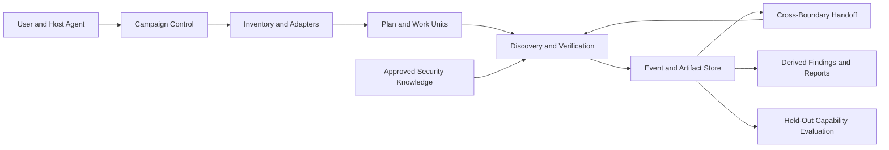

# Reachable Audit vNext System Design

Status: target architecture for review. This document describes intended behavior; it
does not claim that every capability is implemented or certified today.

## 1. Purpose

vNext is a reachable-vulnerability audit system for large, mixed-language repositories.
It must combine a resumable audit workflow with security knowledge that gives Agents
specific, testable discovery directions. The system is successful only when it produces
traceable findings and demonstrates balanced discovery capability on held-out evidence.

The language objective is capability across the approved portfolio of 15 programming
languages: C, C++, C#, Go, Java, Rust, Python, JavaScript, TypeScript, Kotlin, Scala,
PHP, Ruby, Swift, and Shell. A single project is not expected to contain all 15.
Language certification may use separate representative projects; mixed-language
projects are additionally used to validate boundary analysis. The roster is versioned in
the runtime portfolio. Existing v3 language lists are migration evidence, not an
implicit authority for selecting or removing a language.

## 2. Goals and Non-Goals

| ID | Goal | Evidence of completion |
|---|---|---|
| G1 | Certify useful, balanced audit capability across 15 languages | Per-language held-out results, including budget-normalized recall and a worst-language view |
| G2 | Guide discovery with portable, provenance-backed security knowledge | Runtime issue catalog and Mechanism Cards are consumed by analysis tasks and tested |
| G3 | Audit a repository containing multiple languages in one Campaign | Inventory, planning, boundary ownership, and evidence integration cover the mixed-language scope |
| G4 | Preserve evidence quality | Findings have source anchors, reachability evidence, counterevidence, and an honest evidence grade |
| G5 | Scale to large repositories and recover from interruption | Campaign/Batch execution, durable events, bounded Work Units, drift invalidation, and handoffs pass real-project tests |
| G6 | Avoid historical compatibility burden | vNext has one canonical schema and does not read or write v2/v3 runtime state |
| G7 | Prove improvement rather than infer it from architecture | Paired, held-out shadow evaluation shows no unacceptable regression and measured improvement |
| G8 | Give Agents concrete, source-anchored code hotspots without treating matches as verdicts | Registered language providers emit candidate locations plus explicit coverage and limitations |

Non-goals:

- Reproducing historical v3 commands, schemas, version guards, or per-version documents.
- Treating the number of knowledge entries as a proxy for audit capability.
- Claiming that a build adapter alone certifies a language.
- Automatically publishing lessons or external vulnerability data into runtime knowledge.
- Requiring one repository to contain all 15 target languages.
- Replacing expert review with a checklist or a single aggregate recall score.

## 3. Design Principles

### 3.1 Keep the engine; restore the security knowledge plane

Campaign state, event storage, task leases, planning, recovery, and report derivation are
the vNext execution foundation. Security knowledge is an explicit, versioned input to
discovery, not a collection of implicit branches in the scheduler. Removing old runtime
compatibility does not require discarding portable security mechanisms learned from
prior audits.

### 3.2 Separate languages, build ecosystems, and project boundaries

A programming language, a build ecosystem, and a deployable component are different
dimensions. Language adapters describe source, symbol, runtime, and testing semantics.
Build adapters describe manifests, targets, and dependency edges. Project inventory
records both without treating one as proof of the other.

### 3.3 Make unknowns visible

Unsupported manifests, unresolved cross-language edges, missing toolchains, unreviewed
files, and deferred security categories must be recorded as explicit limitations. They
must not silently become evidence that a path is absent or safe.

### 3.4 Facts are immutable; conclusions are derived

Source anchors, tool outputs, experiments, human decisions, and Agent submissions are
immutable artifacts/events. Campaign status, coverage, verdicts, and reports are derived
from validated records. Agent prose alone is not evidence.

### 3.5 Runtime knowledge and evaluation answers are isolated

Runtime prompts may consume approved training knowledge only. Held-out cases, expected
findings, and private scoring details are unavailable to the discovery runtime. Any
knowledge promotion requires provenance review and regression evaluation.

## 4. System Context

The system has five logical planes:

1. **Control plane:** Campaign, Batch, planning, scheduling, budgets, leases, recovery,
   and closure.
2. **Inventory plane:** source-language detection, build-unit parsing, component graph,
   and declared or discovered trust boundaries.
3. **Discovery plane:** surface mapping, security-mechanism hypotheses, reachability,
   refutation, experiments, and finding adjudication.
4. **Knowledge plane:** language issue profiles, reusable Mechanism Cards, verification
   recipes, and provenance controls.
5. **Evaluation plane:** independent per-language and mixed-language held-out testing,
   paired comparison, and promotion gates.

The control plane may schedule work but must not own vulnerability-specific heuristics.
The discovery plane must receive explicit scope, applicable knowledge, analysis
instructions, and output contracts for every task.

## 5. Campaign and Mixed-Language Scope

A Campaign represents one frozen repository snapshot. Its inventory may contain several
languages and build ecosystems. Components and Work Units retain file-level language
ownership; language sets are summaries, not replacements for file-level ownership.

The plan covers:

- every supported source file, or an explicit excluded/deferred scope entry;
- every recognized build unit and its parser status;
- each component-to-component edge and its evidence;
- cross-language boundaries such as FFI, RPC, IPC, serialization, shared storage, and
  generated interfaces;
- an owner and reviewer for every boundary requiring work across Work Units or Batches.

Build dependencies are useful boundary evidence but are not a complete call graph.
Language/build adapters may propose edges; Agents or reviewers must confirm security
relevant edges with source evidence. A missing edge is never inferred from an unsupported
build manifest. Unresolved boundaries remain open and block any finding whose proof
depends on them, while unrelated work may continue.

One Campaign can complete mixed-language analysis when all required component and
boundary work is closed. This is distinct from certifying the system for all 15 languages,
which is measured over a portfolio of separate language-specific samples.

## 6. Discovery Workflow

The existing R0-R6 semantics remain the workflow vocabulary, with one canonical schema:

| Stage | Responsibility | Required output |
|---|---|---|
| R0 | Freeze snapshot, scope, tools, and constraints | Signed Campaign/Batch baseline and explicit blockers |
| R1 | Map external surfaces, principals, components, and boundaries | Source-anchored inventory and boundary records |
| R2 | Generate and screen hypotheses using multiple discovery axes and approved knowledge | Falsifiable hypotheses with axis, language, mechanism, and seed provenance |
| R3 | Verify reachability and vulnerability mechanism | Call/dataflow evidence, counterevidence, and provisional verdict |
| R3.5 | Independent refutation and adjudication | Reviewer evidence and explicit disposition |
| R4 | Execute applicable security-category reviews | CategoryRun records; zero findings is valid if review is evidenced |
| R5 | Run a justified experiment where behavior requires it | Reproducible experiment artifact and fidelity level, or NEEDS_REVIEW |
| R6 | Close the Batch and reconcile scope, evidence, and handoffs | Derived report and unresolved-risk statement |

Campaign closure is separate from Batch closure. No Batch completion may be reported as
whole-project completion. A finding cannot be promoted to reachable without an evidenced
path from a declared principal to the affected operation. An unsupported strong impact
claim must be downgraded or marked NEEDS_REVIEW.

Discovery axes are complementary prompts, not six mandatory full-repository passes.
The Planner selects axes by scope and risk; every omitted axis requires an applicability
reason. The axes are surface, mechanism, state/lifecycle, fix variant, boundary, and
differential behavior.

Registered language hotspot providers may add source-anchored candidate locations to
R1/R2 task context. A hotspot is a review lead, never a vulnerability verdict. Each
provider reports scanned paths, unsupported paths, rule IDs, and known blind spots;
no match or no registered provider must never be presented as evidence of safety.
Provider coverage and candidate quality are evaluated separately from Agent verdicts.

## 7. Security Knowledge Model

The runtime knowledge plane has two linked layers:

1. **Language Issue Profile:** exactly ten prioritized security issue patterns for each
   language in the approved 15-language portfolio. Each entry has a stable issue ID,
   rank, applicable mechanism/card IDs, CWE references where meaningful, source/sink
   cues, language-specific pitfalls, counterevidence, and verification guidance.
2. **Mechanism Card:** a reusable, potentially cross-language description of a root
   cause, its preconditions, dangerous transitions, sink semantics, counterevidence,
   and a falsifiable verification recipe.

Issue rank is a discovery-priority signal, not a severity verdict or a claim that other
weaknesses are out of scope. Shared mechanisms may support multiple language profiles;
language-specific semantics remain in adapters or profile supplements.

Every knowledge item carries provenance and one of these evidence states:

- `seeded`: derived from a reviewed source, checklist, advisory, or general mechanism;
- `battle_observed`: observed in an audit, with project-specific details removed from
  runtime text;
- `battle_reproduced`: independently reproduced against a held-out or controlled
  sample, with evidence reference;
- `deprecated`: retained for traceability but excluded from runtime prompts.

These states must not be collapsed into a single “verified” flag. Project names, absolute
paths, private APIs, and expected held-out answers stay out of runtime knowledge. A
provenance manifest may retain restricted source references outside prompt payloads.

Historical knowledge is mined selectively. An offline, one-way extraction may read old
assets, but vNext runtime never imports old queue formats, schemas, version fields, or
project-specific examples. Each extracted item is reviewed for portability, current
validity, redundancy, and a real consumer before publication.

## 8. Language Capability and Mixed-Language Evaluation

Language certification is independent of repository composition. The release portfolio
must certify every one of the 15 approved languages using representative held-out
projects. At least one separate mixed-language Campaign must exercise real cross-language
boundaries; it need not contain all 15 languages.

The evaluation reports, at minimum:

- recall at a fixed, recorded budget for each language and security issue family;
- macro-average recall and worst-language / worst-family recall;
- precision or false-positive rate and NEEDS_REVIEW rate;
- unique confirmed findings, deduplicated by root cause;
- evidence-grade distribution and unresolved-boundary rate;
- time, Agent runs, token/tool usage, and experiment cost;
- mixed-language boundary coverage and cross-boundary finding results.

Thresholds, expected-finding adjudication, project selection, and minimum sample sizes
must be frozen before runs begin. A release cannot pass by submitting only the languages
that performed well. Reports must show missing languages and inadequate sample sizes as
BLOCKED, not silently omit them. Aggregate improvement cannot hide a material regression
in any certified language.

The paired v3/vNext comparison uses identical snapshots, budgets, and independently
adjudicated expected findings. Synthetic fixtures test the evaluator only and never
count as capability evidence. Test-set membership and expected answers are not available
to runtime agents.

## 9. Large-Repository and Recovery Requirements

Campaign/Batch planning is the mechanism for large repositories, not a claim of proven
20GB support. Work Units are stable ownership scopes; Batches are resumable execution
transactions. The planner accounts for source volume, components, languages, build
targets, surfaces, boundaries, and empirical-test cost. Rebalancing is an explicit plan
amendment that preserves completed evidence.

Cross-Batch Handoffs have one owner, evidence-backed resolution, and a mechanically
integrated chain. Open handoffs block dependent findings and Campaign closure. Snapshot
drift invalidates only affected evidence and dependent conclusions; it cannot silently
mix evidence from different source states.

20GB+ capability is certified only by a real representative Campaign that records
resource use, interruption/recovery, scope coverage, and final evidence reconciliation.

## 10. Knowledge and Release Governance

Knowledge changes and engine changes are evaluated separately. A card/profile release
must include schema validation, provenance validation, language applicability tests,
positive and counterexample fixtures, and a held-out leakage scan. A card that has no
consumer, unclear evidence, or untestable instructions is not published.

Promotion requires all of the following:

1. All 15 approved languages meet their predeclared certification gates.
2. Mixed-language boundary evaluation passes its declared coverage and evidence gates.
3. Held-out recall at equal budget does not materially regress in any language; overall
   and targeted improvements meet predeclared thresholds.
4. False positives and NEEDS_REVIEW remain within policy.
5. Large-repository, recovery, handoff, traceability, and deprojecting checks pass on
   real artifacts.
6. No v3 runtime compatibility is introduced as a shortcut.

If any gate lacks real evidence, vNext remains an experimental shadow candidate and v3
remains the production skill.

## 11. Current State and Design Boundary

The current vNext repository provides Campaign/Batch state, events and artifacts,
planning, durable tasks, generic discovery records, Handoffs, drift handling, experiment
records, and a shadow evaluator. It now also ships 15 language profiles, 150 training
Mechanism Cards, task-context injection, 15 source-language adapters, 14 build adapters,
R5 recipes/probes, and signed RG1-RG11 evaluation logic. These are implementation
capabilities, not evidence that language recall, automatic cross-language discovery,
or 20GB+ operation has passed real acceptance.

Remaining implementation gaps include recognition of arbitrary unknown-language
syntax, compiler-wide call-graph resolution, broader automatic FFI/RPC/IPC and
serialization edge discovery, source-anchored security hotspot providers beyond the
initial implementation slice, and independent protected-store verification of the
held-out answer-set signer. Real per-language held-out data, mixed-language boundary
campaigns, and a 20GB+ recovery campaign remain acceptance evidence to be collected.

The detailed module boundaries and schemas are specified in
`SOFTWARE_DESIGN_VNEXT.md`.