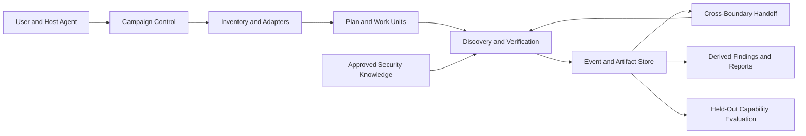

# Reachable Audit vNext System Design

Status: as-implemented architecture baseline, reviewed 2026-10-17 against commit
`beaef3b` plus the working-tree contract repairs. This describes the managed runtime, not guarantees about external Agent
hosts or demonstrated audit capability. Roadmap items are not current contracts;
documenting a known defect does not resolve it.

## 1. Purpose

vNext is an experimental reachable-vulnerability audit workflow for mixed-language
repositories. It combines resumable Campaign/Batch execution with approved security
knowledge supplied to Agent tasks. Scope and evidence-reference validation do not prove
that Agent reasoning is true or that discovery capability is balanced. Capability claims
require external held-out evidence.

The language objective is capability across the approved portfolio of 15 programming
languages: C, C++, C#, Go, Java, Rust, Python, JavaScript, TypeScript, Kotlin, Scala,
PHP, Ruby, Swift, and Shell. A single project is not expected to contain all 15.
Language certification may use separate representative projects; mixed-language
projects are additionally used to validate boundary analysis. The roster is versioned in
the runtime portfolio. Existing v3 language lists are migration evidence, not an
implicit authority for selecting or removing a language.

## 2. Goals and Non-Goals

The following are roadmap and external acceptance goals, not implemented guarantees.
The shipped 15-language roster and ten issue entries per language are versioned catalog
policy, not proof of certification or an architectural optimum.

| ID | Goal | Evidence of completion |
|---|---|---|
| G1 | Certify useful, balanced audit capability across 15 languages | Per-language held-out results, including budget-normalized recall and a worst-language view |
| G2 | Guide discovery with portable, provenance-backed security knowledge | Runtime issue catalog and Mechanism Cards are consumed by analysis tasks and tested |
| G3 | Audit a repository containing multiple languages in one Campaign | Inventory, planning, boundary ownership, and evidence integration cover the mixed-language scope |
| G4 | Preserve evidence quality | Findings have source anchors, reachability evidence, counterevidence, and an honest evidence grade |
| G5 | Scale to large repositories and recover from interruption | Campaign/Batch execution, durable events, bounded Work Units, drift invalidation, and handoffs pass real-project tests |
| G6 | Avoid historical compatibility burden | vNext has one canonical schema and does not read or write v2/v3 runtime state |
| G7 | Prove improvement rather than infer it from architecture | Paired, held-out shadow evaluation shows no unacceptable regression and measured improvement |
| G8 | Give Agents concrete, source-anchored code hotspots without treating matches as verdicts | Registered language providers emit candidate locations plus explicit coverage and limitations |

Non-goals:

- Reproducing historical v3 commands, schemas, version guards, or per-version documents.
- Treating the number of knowledge entries as a proxy for audit capability.
- Claiming that a build adapter alone certifies a language.
- Automatically publishing lessons or external vulnerability data into runtime knowledge.
- Requiring one repository to contain all 15 target languages.
- Replacing expert review with a checklist or a single aggregate recall score.

## 3. Design Principles

### 3.1 Keep the engine; restore the security knowledge plane

Campaign state, event storage, task leases, planning, recovery, and report derivation are
the vNext execution foundation. Security knowledge is an explicit, versioned input to
discovery, not a collection of implicit branches in the scheduler. Removing old runtime
compatibility does not require discarding portable security mechanisms learned from
prior audits.

### 3.2 Separate languages, build ecosystems, and project boundaries

A programming language, a build ecosystem, and a deployable component are different
dimensions. Language adapters describe source, symbol, runtime, and testing semantics.
Build adapters describe manifests, targets, and dependency edges. Project inventory
records both without treating one as proof of the other.

### 3.3 Make unknowns visible

Unsupported manifests, unresolved cross-language edges, missing toolchains, unreviewed
files, and deferred security categories must be recorded as explicit limitations. They
must not silently become evidence that a path is absent or safe.

### 3.4 Facts are immutable; conclusions are derived

Source anchors, tool outputs, experiments, human decisions, and Agent submissions are
immutable artifacts/events. Campaign status, coverage, verdicts, and reports are derived
from validated records. Agent prose alone is not evidence.

Corrections are limited. R6 projections and skill reviews support append-only revisions.
Successfully collected R1, per-axis/compact R2, R3, R4, R5, and R6 task outputs may be amended before
their stage commits, retaining prior/replacement artifacts, reason, actor, and evidence.
Terminal R6 task output may also be amended after Batch commit while the Campaign is not
COMPLETE; the R6 projection must be recommitted, and Campaign closure rejects a pending
R6 amendment until a newer projection exists. R1-R5 post-commit amendment, general
dependent-stage recomputation, and amendments after Campaign completion remain absent;
idempotent stage submission is not a general correction path.

### 3.5 Runtime knowledge and evaluation answers are isolated

The catalog loader admits reviewed training knowledge and rejects held-out or deprecated
cards. Held-out answers are not shipped with the runtime. External hosts must isolate
their files and prompts; the runtime cannot prove that an Agent has not received answers
or prior target context. Semantic knowledge review is an operator assertion, not a
mechanically verified publication guarantee.

### 3.6 Campaign history is explicit and isolated

Campaigns default to `fresh`; their managed discovery context contains the current
snapshot and approved generic runtime knowledge, not prior Campaign findings, lessons,
scope decisions, or skill-regression issues. A `follow-up` Campaign names same-target
source Campaigns at creation. Their artifacts may be consulted only as declared context;
they do not automatically become R1/R2 seeds. Skill-regression backlog is a separate
tool-QA channel and is not vulnerability-discovery knowledge. Migrated Campaigns without
this metadata are `legacy`, never silently treated as fresh.

Every declared unreviewed scope item at closure is paired with an `EXCLUDED` or `DEFERRED` disposition,
current snapshot, evidence, rationale, and approver. A historical scope decision may
inform a follow-up, but cannot substitute for current evidence and approval. Closure
reports distinguish passed gates from declared unreviewed scope. These controls apply
to managed Campaign/state inputs; host prompts/sessions are outside runtime enforcement
and clean-room provenance is not evaluator-checked.

## 4. System Context

The system has five logical planes:

1. **Control plane:** Campaign, Batch, planning, scheduling, budgets, leases, recovery,
   and closure.
2. **Inventory plane:** source-language detection, build-unit parsing, component graph,
   and declared or discovered trust boundaries.
3. **Discovery plane:** surface mapping, security-mechanism hypotheses, reachability,
   refutation, experiments, and finding adjudication.
4. **Knowledge plane:** language issue profiles, reusable Mechanism Cards, verification
   recipes, and provenance controls.
5. **Evaluation plane:** independent per-language and mixed-language held-out testing,
   paired comparison, and promotion gates.

The control plane may schedule work but must not own vulnerability-specific heuristics.
The discovery plane must receive explicit scope, applicable knowledge, analysis
instructions, and output contracts for every task.

## 5. Campaign and Mixed-Language Scope

A Campaign represents one frozen repository snapshot. Its inventory may contain several
languages and build ecosystems. Components and Work Units retain file-level language
ownership; language sets are summaries, not replacements for file-level ownership.

The plan assigns every inventoried source file to exactly one Work Unit and Batch.
Source recognition uses supported/known-unsupported extensions plus source-like
heuristics; arbitrary unknown-language syntax is not reliably detected. Path-level
roles and included/excluded/deferred plan entries are not modeled. Components without
source, manifests, or boundary obligations may be omitted; one Work Unit remains for an
otherwise empty plan. Build parsing records diagnostics. Supplied graph edges retain
evidence and cross-Batch Handoff ownership. Automatic candidates primarily come from
supported build dependencies and imports, not complete FFI/RPC/IPC discovery.

Build dependencies are useful boundary evidence but are not a complete call graph.
Language/build adapters may propose edges; Agents or reviewers must confirm security
relevant edges with source evidence. A missing edge is never inferred from an unsupported
build manifest. Handoffs support an evidence-backed `NOT_SECURITY_BOUNDARY` disposition
separate from `NEEDS_REVIEW`; unresolved boundaries remain open and block any finding
whose proof depends on them, while unrelated work may continue.

The Plan classifies every inventory path as INCLUDED, EXCLUDED, or DEFERRED. Only
INCLUDED paths are assigned to Work Units; other paths remain visible in Campaign
coverage and reports. Exclusions/deferments require rationale, evidence refs, and an
approver declaration that is not authenticated identity. Closure-level declared
unreviewed scope remains a separate broader decision and does not rewrite Plan ownership.

Closure classifies a Work Unit as screening-only when all planned axes are
NOT_APPLICABLE and it has no hypotheses; any APPLICABLE axis contributes to the
substantive Work Unit count. These are axis-derived counts, not path-level review
altitude or risk-weighted inspection evidence. An optional init-frozen screening ceiling
produces report status and release eligibility. Missing/exceeded ceilings do not by
themselves block Campaign closure; authenticated overrides and evaluator enforcement
are absent.

One Campaign can complete mixed-language analysis when all required component and
boundary work is closed. This is distinct from certifying the system for all 15 languages,
which is measured over a portfolio of separate language-specific samples.

## 6. Discovery Workflow

The existing R0-R6 semantics remain the workflow vocabulary, with one canonical schema:

| Stage | Responsibility | Required output |
|---|---|---|
| R0 | Compare scoped source digests with the Campaign baseline | Content-addressed digest receipt; no baseline signature |
| R1 | Record surfaces, principals, components, and supplied-boundary reviews | Source-anchored Surface and BoundaryReview records; final per-Surface states are recorded by R6, while path-role ledger remains absent |
| R2 | Generate and screen hypotheses using multiple discovery axes and approved knowledge | Falsifiable hypotheses with axis, language, mechanism, and seed provenance |
| R3 | Verify reachability and vulnerability mechanism | Call/dataflow evidence, counterevidence, and provisional verdict |
| R3.5 | Independent refutation and adjudication | Reviewer evidence and explicit disposition |
| R4 | Execute applicable security-category reviews against planned Work Units and hypotheses | CategoryRun records; zero findings is valid if review is evidenced |
| R5 | Record assessments and managed experiments | Fidelity-bound artifacts; STATIC_VERDICT_RETAINED, EMPIRICALLY_CONFIRMED, REFUTED, NEEDS_REVIEW, or NOT_FEASIBLE assessments |
| R6 | Close the Batch and reconcile scope, evidence, and handoffs | Derived report and unresolved-risk statement |

Campaign closure is separate from Batch closure. No Batch completion may be reported as
whole-project completion. A finding cannot be promoted to reachable without an evidenced
path from a declared principal to the affected operation. An unsupported strong impact
claim must be downgraded or marked NEEDS_REVIEW.

R4 CategoryRuns may optionally attribute already-recorded canonical Findings through
`finding_ids`; this field is not a Finding creation channel. The canonical Batch finding
count is derived from `FINDING_RECORDED` events, while R4 reports the distinct count of
linked findings separately. A category review with no linked findings is not evidence
that no issue exists beyond the hypotheses in scope; preserve any new candidate as an
explicit unresolved risk or route it through the hypothesis workflow.

For late candidates, the currently supported recovery is an explicitly declared
follow-up Campaign with new hypothesis/verification/refutation records. Preserve the
original unresolved risk and history; this is not automatic reopening of committed
stages. The synthetic mixed-language Handoff fixture exercises that limited recovery.

R1 Surface records do not store final review dispositions. Durable R6 task output
requires exactly one agent-reported `REVIEWED`, `DEFERRED`, `NOT_APPLICABLE`, or
`UNREVIEWED` state for every R1 Surface and rejects missing, extra, or duplicate IDs.
In-process `BatchClosure` projection materializes absent records as `UNREVIEWED`, never
as reviewed. This is not host-observed reading evidence or proof that a Surface is safe. CG3 still
reconciles Surface identity/ownership, Work Unit axis review, planned axis coverage,
references, and hypothesis/verdict identity. A Surface without a hypothesis remains
allowed; path roles/exclusions and general accepted-R3 verdict amendment remain absent.

R2 schedules all six axes, either separately or in one compact task per Work Unit:
surface, mechanism, state/lifecycle, fix variant, boundary, and differential behavior.
AxisRun records require applicability, rationale, and evidence. Planning rejects axis
subsets because they are not supported end to end. All-six execution remains policy,
not a proven optimum for recall or cost.
Six axes do not establish six independent line-by-line passes.

Coverage summarizes axis-derived Work Unit counts, source ownership, and closure scope
decisions, not screened/inspected/deferred paths by risk tier. NOT_APPLICABLE is a scoped
decision, not a safety result; these counts are not held-out inspection recall.

Registered language hotspot providers may add source-anchored candidate locations to
R1/R2 task context. A hotspot is a review lead, never a vulnerability verdict. Each
provider reports scanned paths, unsupported paths, rule IDs, and known blind spots;
no match or no registered provider must never be presented as evidence of safety.
Provider coverage and candidate quality are evaluated separately from Agent verdicts.
NOT_FEASIBLE is valid only when an experiment is required, no attempt was run, the
experiment ID is null, and blocker evidence/rationale are supplied. An attempted but
inconclusive experiment remains NEEDS_REVIEW with its experiment artifact. NOT_FEASIBLE
is reported as unresolved and cannot confirm safety, vulnerability, or refutation. An
authorized out-of-band observation registration contract remains absent; a reference
string alone cannot satisfy managed-run empirical confirmation requirements.

## 7. Security Knowledge Model

The runtime knowledge plane has two linked layers:

1. **Language Issue Profile:** exactly ten prioritized security issue patterns for each
   language in the approved 15-language portfolio. Each entry has a stable issue ID,
   rank, applicable mechanism/card IDs, CWE references where meaningful, source/sink
   cues, language-specific pitfalls, counterevidence, and verification guidance.
2. **Mechanism Card:** a validated training record with root-cause guidance,
   preconditions, transitions, sink semantics, counterevidence, and a verification recipe.
   Shipped cards are language-specific and substantially templated; the reusable
   cross-language variant model remains unimplemented.

Issue rank is a discovery-priority signal, not severity or permission to ignore other
weaknesses. Task assembly filters by family/language, selects ranked entries round-robin
across languages, and records omitted entries under an entry-count, not token, budget.
Cross-language reuse with explicit variants remains a roadmap goal. The first managed
coordinator binds the complete catalog content/version to the Campaign; later loads
must match its content-addressed snapshot, even when a version string is unchanged.

Every knowledge item carries provenance and one of these evidence states:

- `seeded`: derived from a reviewed source, checklist, advisory, or general mechanism;
- `battle_observed`: observed in an audit, with project-specific details removed from
  runtime text;
- `battle_reproduced`: independently reproduced against a held-out or controlled
  sample, with evidence reference;
- `deprecated`: retained for traceability but excluded from runtime prompts.

These states must not be collapsed into a single “verified” flag. Project names, absolute
paths, private APIs, and expected held-out answers stay out of runtime knowledge. A
provenance manifest may retain restricted source references outside prompt payloads.

Offline one-way extraction may read old assets, but the runtime does not import old
queue formats or schemas. Extraction emits reviewable records; publication review is
an operator assertion. Semantic quality, redundancy, and a real consumer are not all
mechanically verified before publication.

## 8. Language Capability and Mixed-Language Evaluation

The following are external acceptance objectives, not measured capability. The evaluator
checks signed attestations and artifact digests; its trusted signer is responsible for
adjudication and held-out provenance. It is not an independent protected-answer service.

Language certification is independent of repository composition. The release portfolio
must certify every one of the 15 approved languages using representative held-out
projects. At least one separate mixed-language Campaign must exercise real cross-language
boundaries; it need not contain all 15 languages.

The evaluation reports, at minimum:

- recall at a fixed, recorded budget for each language and security issue family;
- macro-average recall and worst-language / worst-family recall;
- precision or false-positive rate and NEEDS_REVIEW rate;
- unique confirmed findings, deduplicated by root cause;
- evidence-grade distribution and unresolved-boundary rate;
- time, Agent runs, token/tool usage, and experiment cost;
- mixed-language boundary coverage and cross-boundary finding results.

Thresholds, expected-finding adjudication, project selection, and minimum sample sizes
must be frozen before runs begin. A release cannot pass by submitting only the languages
that performed well. Reports must show missing languages and inadequate sample sizes as
BLOCKED, not silently omit them. Aggregate improvement cannot hide a material regression
in any certified language.

The paired v3/vNext comparison uses identical snapshots, budgets, and independently
adjudicated expected findings. Synthetic fixtures test the evaluator only and never
count as capability evidence. Test-set membership and expected answers are not available
to runtime agents.

## 9. Large-Repository and Recovery Requirements

Campaign/Batch planning is the mechanism for large repositories, not a claim of proven
20GB support. Work Units are stable ownership scopes; Batches are resumable execution
transactions. Partitioning uses source-file and Work Unit limits within component
ownership, retaining language and supplied-boundary metadata. It does not optimize by
surfaces, token volume, or experiment cost. Plan amendments are explicit records.
Optional caller-profile forecasts assume compact R2 and sum per-Batch scenarios,
including per-Batch rounding and one R6 task per Batch. R4 never bundles across Batches.
Measured-rate and hypothesis assumptions remain unvalidated; forecasts are advisory,
not enforced budgets. Released, expired, cancelled, or active claims without terminal
usage records make the separate attempt-cost view incomplete.

Cross-Batch Handoffs have one owner, typed edge/endpoint-bound proof for EDGE_PROVEN
resolution, and a mechanically integrated chain. The proof carries interface direction,
principal/premises, endpoint evidence, and data mappings; the resolver checks planned
edge identity, endpoint ownership, and evidence-reference resolution. These are
structural checks on Agent declarations, not independent proof of semantic truth or
complete boundary discovery. Open handoffs block dependent findings and Campaign
closure. Snapshot drift invalidates only affected evidence and dependent conclusions;
it cannot silently mix evidence from different source states.

20GB+ capability is certified only by a real representative Campaign that records
resource use, interruption/recovery, scope coverage, and final evidence reconciliation.

## 10. Knowledge and Release Governance

Catalog loading validates structure, references, review state, partition, and evidence
state. Compatibility/deproject scans exist. Per-card semantic review and positive/
counterexample quality evidence are not universally enforced; those remain promotion
goals, not current publication guarantees.

External promotion policy requires all of the following, beyond the current evaluator:

1. All 15 approved languages meet their predeclared certification gates.
2. Mixed-language boundary evaluation passes its declared coverage and evidence gates.
3. Held-out recall at equal budget does not materially regress in any language; overall
   and targeted improvements meet predeclared thresholds.
4. False positives and NEEDS_REVIEW remain within policy.
5. Large-repository, recovery, handoff, traceability, and deprojecting checks pass on
   real artifacts.
6. No v3 runtime compatibility is introduced as a shortcut.

If any gate lacks real evidence, vNext remains an experimental shadow candidate and v3
remains the production skill.

## 11. Current State and Design Boundary

The current vNext repository provides Campaign/Batch state, events and artifacts,
planning, durable tasks, generic discovery records, Handoffs, drift handling, experiment
records, and a shadow evaluator. It now also ships 15 language profiles, 150 training
Mechanism Cards, task-context injection, 15 source-language adapters, 14 build adapters,
R5 recipes/probes, and signed RG1-RG15 evaluation logic. These are implementation
capabilities, not evidence that language recall, automatic cross-language discovery,
or 20GB+ operation has passed real acceptance.

RG12 checks provider conformance evidence, but the current runtime has one provider and
no independent real precision/coverage acceptance. RG13 validates signed clean-room
provenance fields and digest-linked R1/R2 task inputs, but does not independently
observe host prompt/session contents. RG14 validates digest-backed screening counts/
fraction against the Campaign-frozen ceiling and rejects overrides; it cannot prove
host-observed reading coverage. RG15 validates digest-backed fixture declarations and
qualifying large-run evidence; evaluator mechanics do not constitute real scale
acceptance. These checks do not certify provider quality or actual clean-room isolation.

Release policy checks RG1-RG15 and remains fail closed on any missing or failed evidence.
RG15's evaluator gate is implemented, but promotion remains blocked until qualifying
scale fixture and real Campaign evidence are supplied.
Passing RG1-RG15 sets implemented_subset_status=PASS but leaves status=BLOCKED and
eligible_for_promotion=false. No signed extra field waives an unavailable check.

Remaining implementation gaps include recognition of arbitrary unknown-language
syntax, compiler-wide call-graph resolution, broader automatic FFI/RPC/IPC and
serialization edge discovery, source-anchored security hotspot providers beyond the
initial implementation slice, and independent protected-store verification of the
held-out answer-set signer. Real per-language held-out data, mixed-language boundary
campaigns, and a 20GB+ recovery campaign remain acceptance evidence to be collected.

The detailed module boundaries and schemas are specified in
`SOFTWARE_DESIGN_VNEXT.md`.

The lifecycle-process mapping to ISO/IEC/IEEE 12207 is maintained separately as an
engineering self-assessment, not a conformity or certification claim; see
`LIFECYCLE_CONFORMANCE_VNEXT.md`. Google internal requirements are not available to
this project unless supplied as controlled evaluation criteria.